# Design: (a) Kit skeleton + animated ghost persona

Implements `requirements.md` in this folder. Architecture decisions come from `docs/ARCHITECTURE.md` (final); this document refines the interface sketches there and says what changes, and why, where it differs.

## 1. Overview

```mermaid
flowchart LR
  subgraph core["packages/core (pure TS)"]
    i18n[i18n catalogs + pickLocale]
    engine[engine: reduce, validatePack]
    input[input types + keyboard adapter]
    timeline[speech: buildTimeline]
    ghost[ghost: ghostPose]
    llm[llm: LLMProvider, withFallback, DemoProvider, evaluator]
  end
  subgraph web["packages/web (browser, no React)"]
    runtime[session runtime: executes effects]
    silent[SilentOutput]
    clock[systemClock, browserLanguages]
  end
  subgraph ui["packages/ui (React)"]
    shell[AppShell, PrivacyDialog, LanguageSwitch, PreviewBadge]
    ghostc[Ghost + useGhostPose]
    caps[Captions + Transcript]
    kb[KeyboardInput]
    conf[ConfirmAnswer]
    fb[FeedbackPanel]
    sess[useSession]
  end
  interview[apps/ghost-interview] --> ui
  defense[apps/ghost-defense] --> ui
  ui --> web --> core
```



One session in `ghost-interview` (phase 1):
1. Intro: the ghost greets (muted line with captions).
2. Privacy: the privacy dialog opens; the user accepts.
3. Asking: the ghost says the question. The keyboard input is already usable (Req 4.6).
4. Answering: the ghost listens once the line ends.
5. Confirming: the user submits; the confirm view shows the text and method, with Confirm, Edit, Retry.
6. Evaluating: the ghost thinks; the demo evaluator runs locally.
7. Feedback: the ghost reacts and says the summary; the panel shows strength and improvement, labeled practice feedback.
8. Summary: closing line.

## 2. Workspace and tooling (Req 1, 2, 13.4)

### Layout created in this spec
```
package.json            scripts only; no runtime deps; "packageManager": "pnpm@<pinned>"
pnpm-workspace.yaml     packages/*, apps/*
tsconfig.base.json      strict, ES2022, moduleResolution "bundler", noEmit
eslint.config.js        typescript-eslint recommended + react-hooks for ui and apps
vitest.config.ts        projects: core (node), web (jsdom), ui (jsdom)
netlify.toml
scripts/build-site.mjs
site/index.html
.github/workflows/ci.yml
docs/DEPLOY.md
packages/{core,web,ui}/  package.json, tsconfig.json, src/
apps/{ghost-interview,ghost-defense}/  package.json, tsconfig.json, vite.config.ts, index.html, src/, e2e/ (interview only in phase 1)
```

### Root scripts (single-shot, Req 1.2, 1.3)
| Script | Runs |
|---|---|
| `pnpm typecheck` | `tsc -p` for every package and app |
| `pnpm lint` | `eslint .` |
| `pnpm test` | `vitest run` (all projects) |
| `pnpm build` | each app's `vite build`, then `node scripts/build-site.mjs` |
| `pnpm e2e` | `playwright test` in `apps/ghost-interview` (builds, then serves with `vite preview` through Playwright's `webServer`, which stops when tests end) |

### Package boundaries (Req 2)
- **No package build step.** Each package's `exports` points at `./src/index.ts`; Vite, Vitest and (later) Netlify's function bundler read TypeScript directly. Apps can only import what `exports` exposes (Req 2.3).
- `packages/core/tsconfig.json`: `lib: ["ES2022"]`, `types: []`, no `jsx` option. A DOM global fails with "Cannot find name 'window'"; a `.tsx` file or JSX fails because `jsx` is unset; `react` is not in core's dependencies, so pnpm's strict `node_modules` can't resolve it (Req 2.1).
- `packages/web/tsconfig.json`: `lib: ["ES2022", "DOM"]`; `react` not in its dependencies, so an import fails to resolve (Req 2.2).
- The root `package.json` must not list `react`, or packages could resolve it through the root `node_modules`.
- Verification (no extra code): add a probe file importing `react` and using `window` in core, run `pnpm typecheck`, see it fail, delete the probe. Same for web with `react`.
- `.gitignore`: `node_modules`, `dist`, `test-results`, `playwright-report`, `.netlify`. Nothing matching `.kiro` (Req 1.4).

### Dependencies (to approve)
Runtime: `react`, `react-dom` (ui and apps only).
Dev: `typescript`, `vite`, `@vitejs/plugin-react`, `vitest`, `jsdom`, `fast-check`, `@testing-library/react`, `@testing-library/user-event`, `@playwright/test`, `@axe-core/playwright`, `eslint`, `typescript-eslint`, `eslint-plugin-react-hooks`.
Versions are pinned to the latest stable at install time. No Prettier, router, state library, CSS framework or i18n library.

### Node and pnpm
Local Node is v26, which no longer bundles Corepack, so pnpm is installed with `npm install -g pnpm`. Netlify and CI pin Node 24 (LTS) through `NODE_VERSION` and `actions/setup-node`.

## 3. packages/core

### 3.1 i18n (Req 9)
```ts
export type Locale = 'en' | 'es';
export type Localized<T> = Record<Locale, T>;
export type Catalog<K extends string> = Localized<Record<K, string>>;

// Both directions are checked: es must have exactly en's keys (Req 9.3).
export function defineCatalog<K extends string>(en: Record<K, string>, es: Record<NoInfer<K>, string>): Catalog<K>;
export function format(template: string, params?: Record<string, string>): string; // "{name}" placeholders
export function pickLocale(preferred: readonly string[]): Locale;                // first "es*" or "en*", else 'en'
```
- An extra key in `es` fails because object literals are checked for excess properties; a missing key fails as a missing property.
- Kit strings (privacy notice, confirm view, buttons, ghost generic lines, demo feedback templates, ghost labels) live in `packages/core/src/i18n/kit-messages.ts`. App strings live in each app's `messages.ts`, built with the same `defineCatalog`.
- Spanish uses "tú" (Req 9.4); copy follows the `ghost-persona` skill.

### 3.2 Input types and keyboard adapter (Req 6)
Types as in ARCHITECTURE.md §3.1 (`InputAdapter`, `InputEvent`, `AnswerCandidate`, `AnswerKind`, `InputMethodId`).

```ts
export interface KeyboardAdapter extends InputAdapter {
  submit(text: string): { ok: true } | { ok: false; reason: 'empty' };
}
export function createKeyboardAdapter(): KeyboardAdapter;
```
- `supports: ['free-text', 'choice', 'yes-no']`, `requires: { camera: false, microphone: false }`, `checkAvailability()` always available.
- `submit` trims; empty or whitespace → `{ ok: false, reason: 'empty' }` and no event (Req 6.4); otherwise emits `{ type: 'candidate', candidate: { text, method: 'keyboard' } }` to the `emit` given in `start` (Req 6.3).
- It lives in core because it needs no DOM. The text field is `KeyboardInput` in ui.
- Phase 1 renders `choice` and `yes-no` as free text with the options listed in the question; dedicated widgets come when a pack uses them (no pack does yet).

### 3.3 Engine (Req 5, 7)
```ts
export interface KeyPoint { label: Localized<string>; cues: Localized<string[]> } // cues: lowercase keywords
export interface Question { id: string; kind: AnswerKind; prompt: Localized<string>; keyPoints: KeyPoint[] }
export interface QuestionPack { id: string; greeting: Localized<string>; closing: Localized<string>; questions: Question[] }

declare const confirmedBrand: unique symbol;
export type ConfirmedAnswer = AnswerCandidate & { readonly candidateId: number; readonly [confirmedBrand]: true };

export type Phase = 'intro' | 'privacy' | 'asking' | 'answering' | 'confirming' | 'evaluating' | 'feedback' | 'summary';

export type SessionEvent =
  | { type: 'start' }
  | { type: 'privacy-accepted' }
  | { type: 'line-done'; lineId: number }
  | { type: 'candidate'; candidate: AnswerCandidate }
  | { type: 'retry' }
  | { type: 'edit' }
  | { type: 'confirm'; candidateId: number }
  | { type: 'feedback-ready'; feedback: Feedback }
  | { type: 'next' }
  | { type: 'locale-changed'; locale: Locale };

export type Effect =
  | { type: 'speak'; lineId: number; line: LineRef }   // LineRef = message key + params, or a Localized<string>
  | { type: 'evaluate'; question: Question; answer: ConfirmedAnswer; locale: Locale };

export function initialState(pack: QuestionPack, locale: Locale): SessionState;
export function reduce(state: SessionState, event: SessionEvent): { state: SessionState; effects: Effect[] };
```
Transitions:
| From | Event | To | Effects |
|---|---|---|---|
| intro | start | privacy | speak greeting |
| privacy | privacy-accepted | asking | speak question |
| asking | line-done (current line) | answering | none |
| asking, answering | candidate | confirming (stores candidate with a new `candidateId`) | none |
| confirming | retry | answering (candidate cleared) | none |
| confirming | edit | answering (`draft` = candidate text) | none |
| confirming | confirm (matching `candidateId`) | evaluating | evaluate with the branded answer |
| evaluating | feedback-ready | feedback | speak feedback summary |
| feedback | next | asking (next question) or summary | speak question or closing |
| feedback | locale-changed | evaluating | evaluate again with the same confirmed answer and the new locale |
| any | locale-changed | same phase, new locale | none |
| other combinations | any | unchanged | none |

Design choices:
- **Confirmation by type (Req 5.2, 5.3)**: `ConfirmedAnswer` carries a `unique symbol` brand that is not exported, so only `reduce` can create one, and only on a `confirm` whose `candidateId` matches the stored candidate.
- **Effects carry message references, not text**, so a language switch re-renders captions and panels without losing progress (Req 9.2). Feedback is the exception: evaluators return text, so the engine re-runs the evaluation on `locale-changed` in the feedback phase. That is free in demo mode; spec (e) decides whether to keep it for real providers.
- **No time anywhere (Req 5.4, 5.6)**: the reducer takes no clock and has no timer effect; only user events (`candidate`, `retry`, `edit`, `confirm`, `next`) leave `answering` and `confirming`. Time is used only by the ghost and timeline (§3.5, §3.6) through an injected `now`.
- **`asking` accepts `candidate`** so input never waits for the ghost (Req 4.6).

### 3.4 Pack validator (Req 5.5)
```ts
export type PackIssue =
  | { kind: 'too-few-inputs'; questionId: string; severity: 'warning' | 'error'; supportedBy: InputMethodId[] }
  | { kind: 'no-questions'; severity: 'error' };
export function validatePack(pack: QuestionPack, adapters: readonly InputAdapter[], opts: { preview: boolean }): PackIssue[];
```
- An issue is reported for each question whose `kind` fewer than 2 input methods support (counted by adapter id); severity is `warning` when `preview`, else `error`.
- A pack with zero questions returns only `{ kind: 'no-questions', severity: 'error' }`, even in Preview, because `reduce` needs a question (owner decision after task 7). `kind` lets the shell pick the localized reason.
- The runtime (§4.1) refuses to start a session if any issue is an `error`, and the shell shows the localized reason. In Preview it logs warnings with `console.warn` and starts.

### 3.5 Speech timeline (Req 4.3)
```ts
export type Viseme = 'rest' | 'A' | 'O' | 'MBP';               // phase 2 adds 'E' | 'U' | 'FV'
export interface WordCue  { index: number; text: string; start: number; end: number }
export interface MouthCue { start: number; end: number; viseme: Viseme }
export interface Timeline { words: WordCue[]; mouth: MouthCue[]; duration: number }
export function buildTimeline(text: string, locale: Locale): Timeline;
```
- Refinement of ARCHITECTURE.md §3.4: words and mouth shapes are separate lists on one shared clock, because a word has several mouth shapes. Captions read `words`, the mouth reads `mouth`. The `rate` parameter arrives with real speech in spec (b).
- Duration per word ≈ letters × 65 ms (EN) or 60 ms (ES), with a 120 ms minimum; pauses of 200 ms after commas and 400 ms after `.`, `?`, `!`.
- Phase 1 letter rules: `a, e, i` → `A`; `o, u` → `O`; `m, b, p, f, v` → `MBP`; other letters keep the previous shape; gaps → `rest`. The last cue is always `rest`.
- Pure; Spanish accents are normalized before mapping (`á` → `a`).

### 3.6 Ghost pose (Req 3)
```ts
export type Expression = 'neutral' | 'thinking' | 'approving' | 'skeptical'; // phase 2 adds 3
export type GhostActivity = 'idle' | 'speaking' | 'listening' | 'thinking' | 'reacting';
export interface GhostState { activity: GhostActivity; expression: Expression; speech?: { timeline: Timeline; startedAt: number }; seed: number }
export interface GhostPose { activity: GhostActivity; expression: Expression; viseme: Viseme; blink: boolean } // phase 2 adds float
export function ghostPose(state: GhostState, now: number, opts: { reducedMotion: boolean }): GhostPose;
```
- **Viseme**: the mouth cue at `now - startedAt`; `rest` when not speaking or past `duration`.
- **Blink**: time is split into 4.5 s cycles; in cycle `k`, a 120 ms blink starts at an offset in [0, 1.5 s) from a seeded hash of `(seed, k)`. Consecutive blinks are therefore 3 to 6 s apart (Req 3.3), deterministic for tests. Under reduced motion, `blink` is always false (Req 3.6).
- **Float (phase 2, Req 3.10)**: phase 1 has no `float` field. Phase 2 adds `float: number` = `sin(now / 2400 ms)` (normalized; the view scales it to a few pixels), always `0` under reduced motion.
- Mapping from session to ghost state lives in ui (§5.2), because it combines the session with the speech playback state.

### 3.7 LLM and demo evaluation (Req 8)
```ts
export type LLMTask = 'evaluate-answer'; // spec (e) adds 'generate-questions' | 'follow-up'
export interface LLMRequest { task: LLMTask; locale: Locale; input: EvaluateInput; maxOutputTokens: number }
export type LLMResult = { ok: true; text: string } | { ok: false; error: 'rate-limited' | 'unavailable' | 'bad-output' | 'too-large' };
export interface LLMProvider { readonly id: 'demo' | 'proxy' | 'gemini' | 'groq'; readonly isDemo: boolean; complete(req: LLMRequest): Promise<LLMResult> }

export function withFallback(...chain: LLMProvider[]): LLMProvider;   // first ok result wins; returns the last error if all fail
export function createDemoProvider(): LLMProvider;                     // no I/O, deterministic
export function createLlmEvaluator(provider: LLMProvider): Evaluator;  // builds the request, parses with isFeedback()
export function isFeedback(value: unknown): value is Feedback;         // hand-written guard
```
- `Feedback`: `{ summary, strength, improvement, reaction: 'approving' | 'skeptical', locale }`. One strength and one improvement (Req 8.2); the plural lists in ARCHITECTURE.md §3.2 are trimmed to what the requirement asks.
- **Demo heuristic** (inside `DemoProvider`, returning JSON text so real providers in spec (e) go through the same guard):
  1. Normalize the answer: lowercase, strip accents, collapse spaces.
  2. A key point matches if any of its cues appears in the answer. Cues from both languages count (the evaluator sends the requested locale's cues first, then the other's), so a language switch changes the text of the feedback, never the result (change after the task 27 walk-through: an English answer re-evaluated after switching to ES lost all its matches).
  3. `reaction` = `approving` if at least half the key points match, else `skeptical`.
  4. Strength: label of the first matched point ("You covered {point}."), or "You took the time to answer." if none matched (owner change after task 13: the demo can't check that an answer was direct, and the summary already says "Thank you").
  5. Improvement: label of the first unmatched point ("Add {point}."); if all matched, "Add one result you can measure."; if the answer has fewer than 8 words, "Say a bit more: one example helps." takes priority.
  6. Summary: one templated line per reaction.
  All templates are kit catalog keys in EN and ES, written with the `ghost-persona` skill (Req 8.4). No randomness, no I/O (Req 8.1, 8.3).
- The panel heading is "Practice feedback" / "Comentarios de práctica" (Req 8.5).
- `withFallback` is required by Req 8.1 and has only one provider in phase 1; its unit test covers a failing provider followed by a working one.

## 4. packages/web

### 4.1 Session runtime
```ts
export interface SessionDeps {
  pack: QuestionPack; adapters: readonly InputAdapter[]; preview: boolean;
  evaluator: Evaluator; speech: SpeechOutput; messages: Catalog<string>; locale: Locale;
}
export type SessionHandle = {
  getSnapshot(): SessionView;              // state + current line text + playback info
  subscribe(listener: () => void): () => void;
  dispatch(event: SessionEvent): void;
} | { blocked: PackIssue[] };              // strict build with validation errors (Req 5.5)
export function createSession(deps: SessionDeps): SessionHandle;
```
- `dispatch` runs `reduce`, stores the state, executes effects, notifies listeners.
- `speak`: resolve the `LineRef` to text in the current locale, build the timeline, call `speech.speak`; when it resolves, dispatch `line-done` with the `lineId`. A newer line cancels the older one.
- `evaluate`: call the evaluator, then dispatch `feedback-ready`.
- Locale changes go through `dispatch({ type: 'locale-changed' })`; the runtime re-resolves the current line's text.
- `getSnapshot` returns a stable object between changes (required by `useSyncExternalStore`).

### 4.2 SilentOutput and clock
```ts
export interface SpeechOutput { speak(timeline: Timeline): { startedAt: number; done: Promise<void> }; cancel(): void }
export function createSilentOutput(clock: Clock): SpeechOutput;   // resolves after timeline.duration with setTimeout
export const systemClock: Clock;                                    // performance.now()
export function browserLocale(): Locale;                            // pickLocale(navigator.languages)
```
- Refinement of ARCHITECTURE.md §3.4: `speak` takes the built timeline and returns `startedAt`, so the ghost and the captions read the same clock origin. `WebSpeechOutput` in spec (b) implements the same interface.

## 5. packages/ui

### 5.1 Components
| Component | Req | Notes |
|---|---|---|
| `AppShell` | 9.2, 10.4, 11.5 | `<header>`: app title, `LanguageSwitch`, privacy link button, `PreviewBadge` when `preview`. `<main>` with `id` and a skip link. Same header on every screen (consistent help, WCAG 3.2.6). Sets `document.documentElement.lang`. |
| `LanguageSwitch` | 9.2 | Two native buttons "English" / "Español" with `aria-pressed` and `lang` on each label. |
| `PreviewBadge` | 11.5 | Visible text "Preview" / "Vista previa" plus a short line: "Keyboard only for now. Voice and Morse are coming." Plain text, not a tooltip. |
| `PrivacyDialog` | 10 | Native `<dialog>` opened with `showModal()`: focus moves in, the rest of the page is inert (10.3). Esc closes it and returns to the intro screen with a Start button; it never starts the session. Read-only mode from the header link. |
| `Ghost` | 3 | Pure SVG view of a `GhostPose`; `role="img"`, `aria-label` from the catalog per expression (3.5). |
| `useGhostPose` | 3, 4.3 | One `requestAnimationFrame` loop; computes `ghostPose` each frame and writes changed attributes through refs, so React does not re-render per frame. Reads `prefers-reduced-motion`. |
| `Captions` | 4.1, 4.2, 4.5 | Full line at once; the current word gets underline + bold (not color alone). Same rAF clock as the ghost. `aria-hidden="true"`, because the transcript announces lines (avoids per-word announcements). Sits in normal flow below the ghost, never overlaying content (4.5). |
| `Transcript` | 4.4 | `<ol>` of finished lines inside a region; a separate visually-hidden `aria-live="polite"` element receives each finished line once. |
| `KeyboardInput` | 6 | `<label>` + `<textarea>`, paste allowed, submit button, Ctrl/Cmd+Enter. Empty submit shows an inline error tied with `aria-describedby` and keeps focus in the field. Prefills from `draft` after Edit (7.3). |
| `ConfirmAnswer` | 7 | Region with a heading ("I noted this. Is that what you meant?") that receives focus on open (7.2), the text in a blockquote, the method ("Typed"), and Confirm, Edit, Retry buttons. |
| `FeedbackPanel` | 8.2, 8.5 | Heading "Practice feedback", strength, improvement, Next button; text marked with the feedback's `lang`. |
| `useSession` | all | `useSyncExternalStore` over the runtime handle. |

Focus on phase change: the newly shown panel's heading (tabindex `-1`) gets focus for confirming, feedback and summary. During asking and answering, focus goes to the text field only when the user starts the session, not on every line.

### 5.2 Ghost state mapping
| Session | Ghost activity / expression |
|---|---|
| a line is playing | speaking / neutral (or the feedback reaction while saying the summary) |
| answering, confirming | listening / neutral |
| evaluating | thinking / thinking |
| feedback, after the line | reacting / `feedback.reaction` |
| intro, summary, no line | idle / neutral |

### 5.3 SVG and visual design
- `viewBox="0 0 240 280"`. Groups with stable ids: `ghost-body` (rounded top, three-lobe hem), `brows`, `eye-left`, `eye-right`, `glasses` (round frames with a bridge), `mouth`, `bowtie`, `clipboard` (held at the lower right), `hands`. Coordinates rounded to 1 decimal. Hand-drawn in this repo; no copied assets.
- Mouth: four pre-drawn `<path>`s, one per viseme; only the active one is visible.
- Expressions change brow rotation and eye shape: `neutral` flat brows; `thinking` one brow raised, eyes up; `approving` brows up, eyes curved; `skeptical` one brow down, eyes narrowed. 200 ms transitions on `transform` only, on `<g>` with `transform-box: fill-box`.
- Phase 2 applies the float to a wrapper `<div>`, not the `<svg>`.
- Matches the owner's Devpost thumbnail (Req 3.11). Distinct from Kiro's mascot: glasses, bow tie, clipboard, mint-white palette, no purple anywhere.
- Ghost colors: body `linearGradient` `#ffffff` → `#e3fbf4` → `#a9e8d6`; glasses `#e8a13a`; bow tie `#e8892f`; eyes, brows, mouth and outlines `#0b1020`.
- **Orange parts get a 2 px `#0b1020` outline.** Orange on the mint-white body measures only 1.6:1 to 2.4:1, so the outline gives the glasses and bow tie their visible edge (8.7:1 against the orange, 13.7:1 or more against the body). The fill colors stay as in the thumbnail.

#### Tokens (`packages/ui/src/tokens.css`)
| Token | Value | Use |
|---|---|---|
| `--bg-start` / `--bg-end` | `#0b1020` / `#14264d` | Page background gradient |
| `--surface` | `#101a36` | Captions, transcript, panels, dialog |
| `--text` | `#f4f7fb` | Body text |
| `--text-muted` | `#c3cee4` | Secondary text |
| `--accent` | interview `#7ff5d4`, defense `#ffd27a` | Focus ring, current-caption underline, links, primary button fill |
| `--on-accent` | `#0b1020` | Text on accent-filled buttons |
| `--error` | `#ffb4a8` | Inline error text |
| `--panel-edge` | `#6b7ba3` | Border of the caption, transcript, confirmation and feedback panels (spec b tasks 33b, 35b) |

#### Contrast check (computed with the WCAG 2.x formula)
| Pair | Ratio | Needs |
|---|---|---|
| `--text` on `--bg-end` (lightest background) | 13.8:1 | 4.5:1 |
| `--text` on `--surface` | 16.0:1 | 4.5:1 |
| `--text-muted` on `--bg-end` | 9.4:1 | 4.5:1 |
| interview accent on `--bg-end` | 11.3:1 | 4.5:1 (as text), 3:1 (focus ring) |
| defense accent on `--bg-end` | 10.4:1 | 4.5:1 / 3:1 |
| `--on-accent` on interview accent | 14.4:1 | 4.5:1 |
| `--on-accent` on defense accent | 13.3:1 | 4.5:1 |
| `--error` on `--bg-end` | 8.7:1 | 4.5:1 |
| `--panel-edge` on `--bg-end` / `--surface` | 3.5:1 / 4.1:1 | 3:1 (to show the panel's edge) |
| Ghost body (darkest stop `#a9e8d6`) on `--bg-end` | 10.8:1 | 3:1 |
| Features `#0b1020` on body (darkest stop) | 13.7:1 | 3:1 |
| Glasses `#e8a13a` on body | 1.6:1 to 2.2:1 | fixed by the outline above |
| Bow tie `#e8892f` on body | 2.4:1 | fixed by the outline above |

All text sits on `--surface` or the background, never over the ghost. axe re-checks the rendered pages in the tasks.
- `@media (prefers-reduced-motion: reduce)` stops blinking (via `useGhostPose`) and caps transitions at 150 ms.

### 5.4 Motion toggle (phase 2, Req 3.7)
Added together with floating. A "Pause motion" / "Pausar movimiento" button in the header (`aria-pressed`). Pressed → `reducedMotion: true` for `useGhostPose`, regardless of the media query. The choice lasts for the page session only (no storage). Phase 1 relies on `prefers-reduced-motion` only.

## 6. Apps

### apps/ghost-interview
- `src/config.ts`: `{ preview: true }` (Req 11.4). Spec (b) sets it to `false`.
- `src/content/pack.ts`: one fictional question, "Tell me about a time you solved a difficult problem." / "Cuéntame de una vez en que resolviste un problema difícil.", with 3 key points (situation, action, result) and EN/ES cues.
- `src/messages.ts`: title "Ghost Interview" / "Entrevista fantasma", greeting and closing lines.
- `src/App.tsx`: composes `AppShell`, `Ghost`, `Captions`, `Transcript`, `PrivacyDialog`, `KeyboardInput`, `ConfirmAnswer`, `FeedbackPanel` with `createSession`. No logic beyond wiring.
- `vite.config.ts`: `base: '/interview/'`.

### apps/ghost-defense (shell only)
- `config.ts` `{ preview: true }`, title "Ghost Defense" / "Defensa fantasma", amber accent.
- Renders `AppShell` + idle `Ghost` + a message: "The document defense is still in development. Try Ghost Interview meanwhile." with a link to `/interview/`. No session.
- `vite.config.ts`: `base: '/defense/'`.

### site/index.html
Static landing page: what Ghost Examiner is, links to both apps, link to the repo. Bilingual with `lang` attributes, no JavaScript.

## 7. Build and deploy (Req 13)

### scripts/build-site.mjs
Copies `site/` to `dist/`, `apps/ghost-interview/dist/` to `dist/interview/`, `apps/ghost-defense/dist/` to `dist/defense/` using `fs.cp`. About 15 lines.

### netlify.toml
```toml
[build]
  command = "pnpm build"
  publish = "dist"

[build.environment]
  NODE_VERSION = "24"
```
No redirects (no client-side routing) and no functions yet (spec e).

### docs/DEPLOY.md (written when the slice builds)
Step-by-step for the owner: create a Netlify account and import the GitHub repo; base directory empty, build command and publish directory read from `netlify.toml`; set the production branch to `release`; in branch deploy settings, add `main`; where to find the branch-deploy URL (`main--<site>.netlify.app`). It also states the cost: importing a site usually starts one production build of the selected branch (15 credits), so that import is an approved production deploy.

### .github/workflows/ci.yml
On push and pull request: checkout, pnpm, Node 24, `pnpm install --frozen-lockfile`, `pnpm typecheck`, `pnpm lint`, `pnpm test` (Req 13.4). End-to-end tests run locally in phase 1.

## 8. Error handling
| Case | Behavior |
|---|---|
| Empty keyboard answer | Inline error, no candidate (6.4) |
| Strict build with pack errors | No session; shell shows the localized reason (5.5) |
| Preview build with pack warnings | `console.warn` per issue; session starts; Preview badge visible |
| `confirm` with a stale `candidateId` | Ignored by the reducer |
| Privacy dialog dismissed with Esc | Back to intro with a Start button |

Not covered (no requirement asks for it): an evaluator that throws or never resolves would leave the session in `evaluating`. The demo evaluator is synchronous and deterministic, so this can't happen in phase 1. Owner-approved: spec (e) gets a requirement for the evaluator failure path (error or timeout → fallback to demo, or a retry message, never a stuck session). Current state after task 15: `createLlmEvaluator` throws on a provider error or bad output, and `createSession` does not catch the rejection, so it is unhandled and the session stays in `evaluating`. Spec (e) fixes it there.

Known gap, left for spec (e) (owner decision after task 7): a language switch during `evaluating` changes the locale but does not re-evaluate (transition table: "any | locale-changed | same phase"), so the pending feedback arrives in the old language. The demo evaluator resolves almost at once, so phase 1 is unaffected; slow real providers in spec (e) need a fix (for example, re-evaluate or drop a `feedback-ready` whose locale differs).

Known gap, left for spec (e) (found in task 12): `withFallback` moves to the next provider only when a provider returns `{ ok: false }`. A provider that returns `ok` text which then fails `isFeedback` does not fall back to demo. The proxy already validates model output and returns `bad-output` (`netlify-proxy-safety` skill), but the bring-your-own-key (BYOK) providers that run in the browser must do the same: parse the model text, check it with `isFeedback`, and return `{ ok: false, error: 'bad-output' }` on failure, so the chain falls back to demo.

## 9. Correctness properties (fast-check, Req 12.1)
| # | Property | Module |
|---|---|---|
| P1 | For any event sequence from `initialState`, every `evaluate` effect comes either from a `confirm` event whose `candidateId` equals the stored candidate's id (and its answer text equals that candidate's text), or from a `locale-changed` event that re-evaluates an answer confirmed earlier in the same sequence. | engine |
| P2 | For any sequence of non-user events (`line-done`, `feedback-ready`, `locale-changed`), a state in `answering` or `confirming` stays in that phase (no timeouts or automatic advance). | engine |
| P3 | `reduce` never throws, and an event invalid for the current phase returns the same state and no effects. | engine |
| P4 | `validatePack` reports a question if and only if fewer than 2 adapters support its kind; severity matches `preview`. | validator |
| P5 | For any text, `buildTimeline` word cues are in order, do not overlap, cover every word in order, and the last mouth cue is `rest` ending at `duration`. | timeline |
| P6 | Appending words to a text never decreases `duration`. | timeline |
| P7 | `ghostPose` is deterministic; under `reducedMotion`, `blink === false` for all `now` (phase 2 adds `float === 0`). | ghost |
| P8 | Without reduced motion, the gap between consecutive blink starts is within [3000, 6000] ms. | ghost |
| P9 | `DemoProvider` + evaluator: same input gives the same feedback; output always passes `isFeedback`. | llm |

Example-based tests cover catalogs (`pickLocale` cases), keyboard adapter, `withFallback`, and each reducer transition in the table in §3.3.

## 10. Testing (Req 12)
- **Component tests** (Vitest + Testing Library): `KeyboardInput` (label, paste, Ctrl/Cmd+Enter, empty error), `ConfirmAnswer` (focus on open, three actions), `PrivacyDialog` (opens modally, Esc behavior), `Ghost` (mouth path and label per pose), `Captions` (current-word marker), `LanguageSwitch` (`lang` update).
- **End-to-end** (`apps/ghost-interview/e2e/slice.spec.ts`, Chromium): the full slice by keyboard only in EN, then the language switch mid-session to ES; asserts captions appear and the transcript gets each line; asserts the confirmation step appears before feedback.
- **Network allowlist** (12.4): `page.on('request')` fails the test on any request whose origin differs from the preview server.
- **axe** (12.3): phase 1 checks intro, privacy dialog, answering, confirming and feedback screens in EN with default motion. Phase 2 extends to EN and ES × `reduce` and `no-preference`, plus the ghost-defense shell.
- **Playwright MCP**: manual keyboard walk-through of the slice before each UI task is marked done (`workflow.md`).

## 11. Requirement traceability
| Req | Where |
|---|---|
| 1 | root workspace files, scripts |
| 2 | package tsconfigs, `exports`, probe check |
| 3 | core `ghost/`, ui `Ghost`, `useGhostPose`, tokens; motion toggle in phase 2 |
| 4 | core `speech/timeline`, web `SilentOutput`, ui `Captions`, `Transcript` |
| 5 | core `engine/`, `validatePack`, web runtime blocking |
| 6 | core keyboard adapter, ui `KeyboardInput` |
| 7 | engine transitions, ui `ConfirmAnswer` |
| 8 | core `llm/`, ui `FeedbackPanel` |
| 9 | core `i18n/`, web `browserLocale`, ui `LanguageSwitch`, `AppShell` |
| 10 | ui `PrivacyDialog`, `AppShell` link, kit catalog |
| 11 | `apps/*`, ui `PreviewBadge` |
| 12 | tests in each package, `apps/ghost-interview/e2e` |
| 13 | `scripts/build-site.mjs`, `site/`, `netlify.toml`, `docs/DEPLOY.md`, CI workflow |

## 12. Phase 1 vs phase 2
- **Phase 1 (Day 5)**: everything above, with 4 expressions and 4 mouth shapes, and axe in EN with default motion.
- **Phase 2**: add `attentive`, `amused`, `surprised` and `E`, `U`, `FV` (types, SVG, timeline rules: `e, i` → `E`, `u` → `U`, `f, v` → `FV`), use `attentive` for listening; add floating with the motion toggle (§3.6, §5.4); run the full axe matrix.
