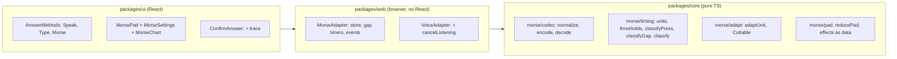

# Design: (c) Morse input
Implements `requirements.md` in this folder. Builds on the designs of spec (a) (`../kit-skeleton-ghost/design.md`) and spec (b) (`../voice-speech/design.md`); only additions and changes are listed here. No new dependencies.
## 1. Overview

One Morse answer, one-key mode, automatic gaps:
1. The user picks the Morse tab of the method selector (§2) and focuses the pad.
2. Holding Space: the pad calls `press(now)` on keydown and `release(now)` on keyup. The adapter feeds the pure reducer (§3.5), which classifies the press as a dot or dash (§3.3).
3. After each release the adapter sets timers for the letter and word boundaries. When one fires, the reducer ends the letter or adds a word gap; the live region announces the finished letter.
4. Each change of the decoded text emits a `partial` event (the ghost looks attentive, spec a 3.4).
5. Enter (Done) ends any letter in progress and emits a candidate `{ text, method: 'morse', trace, notice? }`. The confirmation step shows the text, the method and the trace (§5.5).
## 2. The answering screen: one method at a time (owner request)
### 2.1 The problem and two options
Requirement 2.8 asks that the typed field and voice input stay available next to the Morse pad. Measured today at 320 × 700 in EN (Playwright, answering screen, after the question): the header ends at 168 px, the ghost at 324, the question panel at 430 (462 in ES), the typed form at 738, the voice section runs 762 to 1123 (its button at 808 to 852, below the fold), and the page is 1358 px tall (1412 in ES). Adding a Morse pad of about 360 px below that puts the pad at about 1150 and makes the page about 1740 px tall.
| | A. Everything visible (today's layout plus the pad) | B. One method at a time behind a selector (proposed) |
|---|---|---|
| Height at 320 px | about 1740 px; the pad starts about 2.5 screens down | 1020 to 1110 px; every method starts at 510 px, above the fold |
| Reaching a method | scroll or Tab through the others | one control (the selector), then Tab into the panel |
| Live regions on screen | three at once (typed error, voice status, Morse letters) | one, in the visible panel |
| Voice first (Revisit-later note) | needs a reorder; the typed field then moves down | Speak is the first tab and the default where voice works |
| Risk | the user may never see a method far down the page | a hidden method can be missed; mitigated by visible tab labels and an unavailable marker |
| Cost | none | one new kit component, focus rules, e2e updates (§2.5) |
Choice: **B**. It keeps every method one control away, shows one live region at a time and puts voice first, at the cost of one component and some test churn.
### 2.2 The method selector (`AnswerMethods`, packages/ui)
- An APG tab list with **manual activation**: Left and Right arrows (and Home, End) move focus between tabs, Enter or Space selects. Manual activation, because selecting Type or Morse while listening stops listening (below), and an arrow press should never do that.
- Tabs in this order: **Speak | Type | Morse** ("Hablar | Escribir | Morse"). Each tab controls a `role="tabpanel"` labeled by the tab, so the panels drop their own visible headings (the voice heading "Answer by voice" goes).
- **Default**: when a session starts, Speak if voice is available, otherwise Type. Morse is never the default (it needs learning). The user's last choice is remembered for the page visit (app state, like the motion toggle; never stored) and wins over the default.
- **Unavailable methods** stay in the list: the tab gets a dashed border (the unavailable style of spec b task 19b) and its accessible name gets ", not available" / ", no disponible" after the visible label (WCAG 2.5.3 holds). Selecting it shows the reason in its panel, as today. A method that becomes unavailable mid-session (Brave) never switches the tab by itself (WCAG 3.2.2).
- **All panels stay mounted**; the hidden ones get the `hidden` attribute. So switching never loses anything:
  - typed text stays in the field;
  - Morse in progress stays; on hide, the Morse adapter pauses its gap timers (`pause()`), so no letter or word ends while the pad is hidden, and a held press is cancelled (Req 2.6);
  - **while listening**, selecting Type or Morse calls `voice.cancelListening()`, which stops the recognizer without a candidate and returns the words heard so far. Those words are appended to the typed field (`KeyboardInput` gains `insertText: { id, text }`), so nothing said is lost. Stopping takes that one action (spec b 4.5).
- The selector shows only during asking and answering, as the panels do today.
### 2.3 Focus and live regions
| Moment | Focus | Was |
|---|---|---|
| The session starts (after the privacy notice) | the selected tab, which announces the choice ("Speak, tab, 1 of 3, selected") | the text field |
| Tab from the tab list | into the selected panel's first control (Start speaking, the text field, or the pad) | n/a |
| Edit on the confirmation screen | Type is selected; focus on the prefilled field (spec a 7.3) | the field |
| Answer again | the method of the last answer is selected; focus on its main control: the voice button (spec b 6.3), the field, or the pad (spec c 8.3) | voice button or field |
| A language switch | unchanged (stays on the language switch) | unchanged |
- Live regions: each panel keeps its own region mounted. A `hidden` panel is out of the accessibility tree, so only the visible panel's region can speak. Switching tabs announces only the tab (by focus), never the old panel's last message.
- Trade-off: focusing the tab costs a typing user one Tab press, but tells every user that three methods exist. The alternative (focus the panel's main control) is noted in §12.
### 2.4 Layout at 320 × 700 (EN; ES adds 32 px for the 3-line question)
```text
y=0    ┌────────────────────────────────┐
       │ Ghost Interview                │ header (compact, task 19b)
       │ [Voice] [English] [Español]    │
       │ [Pause] Privacy notice         │
y=168  ├────────────────────────────────┤
       │          (ghost 120 px)        │
y=324  │ ┌────────────────────────────┐ │
       │ │ Tell me about a time you   │ │ question (captions)
       │ │ solved a difficult problem.│ │
y=430  │ └────────────────────────────┘ │
y=454  │ [ Speak ][ Type ][ Morse ]     │ method tabs (44 px)
y=510  │ ┌ Morse panel ───────────────┐ │
       │ │ ·−  | so far: "i fix"      │ │ decoding line (64 px)
y=582  │ │ ┌────────────────────────┐ │ │
       │ │ │ Hold Space, or press   │ │ │ pad target 288 × 120
       │ │ │ here: short · long −   │ │ │
y=702  │ │ └────────────────────────┘ │ │ ← fold at 700
       │ │ [End letter →][Space ↓][⌫]│ │
       │ │ [Clear]        [Done ⏎]    │ │
       │ │ Chart · Practice · Settings│ │
y=870  │ └────────────────────────────┘ │
       │ Transcript …                   │
y≈1110 └────────────────────────────────┘
```
Vertical budget (px, EN; measured rows marked *):
| Block | Today | Proposed, Speak | Proposed, Type | Proposed, Morse |
|---|---|---|---|---|
| Header* | 0 to 168 | same | same | same |
| Ghost* | 184 to 324 | same | same | same |
| Question* | 340 to 430 | same | same | same |
| Tabs | none | 454 to 498 | 454 to 498 | 454 to 498 |
| First control | field 486 to 622*; voice button 808 to 852* | button 510 to 554 | field 542 to 678 | decoding line 510 to 574, pad 582 to 702 |
| Rest of panel | typed form to 738*, voice to 1123* | status, note, "Your words" to about 780 | hint, submit to about 782 | controls to about 870 |
| Page height | 1358* (1412 ES) | about 1020 | about 1020 | about 1110 |
- Above the fold in EN: every method's first control; for Morse, the decoding line and the whole pad (pad bottom at about 702, at the fold). In ES the pad's lowest 34 px fall below the fold. The Morse buttons need one scroll, but every one of them also has a key (§5.2), shown on screen.
- Proposed numbers are estimates from today's measured component sizes, the 44 px tab row and the pad sizes of Req 2.5. Task 21 measures them again.
### 2.5 What this changes in the specs
| Spec | Item | Change |
|---|---|---|
| (a) requirements | 7.3 Edit | none: Edit still opens the keyboard input prefilled; it now also selects Type |
| (a) design §5 | focus when answering starts | the selected tab gets focus, not the text field (§2.3) |
| (b) requirements | 4.4 voice button on the answer screen | amend: "THE Speak panel of the answer screen SHALL offer a visible, keyboard-operable button to start and stop listening." |
| (b) requirements | 4.11 keyboard stays available while listening | amend: "THE keyboard input SHALL stay one control away while listening (the method selector). Selecting another method SHALL stop listening and move the words heard so far into the typed answer field." |
| (b) design §4 | "the order is KeyboardInput, then VoiceInput; focus stays on the text field" | replaced by §2.2 and §2.3 here |
| (c) requirements | 2.8 | amend: "THE pad SHALL NOT block other input: every registered method SHALL stay one control away through the method selector, and switching methods SHALL NOT lose what was typed, said or tapped." |
| (c) requirements | new 2.9 | "THE answer screen SHALL show one method at a time behind a method selector (Speak, Type, Morse), with the default and focus rules of design §2." |
| (c) requirements | glossary and 4.3 | word boundary 4.5u instead of 5u (§3.3) |
Task 1 applies these edits once the owner approves this design.
## 3. packages/core
### 3.1 Types (Req 1, 8)
- `AnswerCandidate.trace?: string`: the Morse code as typed (`docs/ARCHITECTURE.md` §3.1 already plans it). Never used in evaluation (Req 8.4).
- `morse/types.ts`: `Symbol = '.' | '-'`; `Press = { down: number; up: number }` (ms on the caller's clock); `Thresholds = { dash: number; letter: number; word: number }`; `MorseSettings = { mode: 'one-key' | 'two-key'; gaps: 'auto' | 'manual'; wpm: number; adaptive: boolean; announce: boolean }`.
### 3.2 Codes and codec (Req 3)
- `CODES`: one table, character → code: a to z, ñ (`--.--`), 0 to 9, and `. , ? ' ! - / ( ) : " @` (ITU-R M.1677-1, with ñ and `!` (`-.-.--`) as common extensions). `ALPHABET` is its keys. The reverse table is derived from it, so they can't drift.
- Code string format (the trace): symbols of a letter together, letters separated by one space, words by ` / `. Example: "hi you" → `.... .. / -.-- --- ..-`.
- `normalize(text)`: lowercase; strip accents with NFD, but keep ñ; drop characters outside `ALPHABET` and whitespace; collapse whitespace to one space; trim.
- `encode(text)`: `normalize`, then map. Output alphabet `.`, `-`, ` `, `/`.
- `decode(code) → { text, unknown }`: split on ` / ` and spaces; each code maps to its character, or `?` with `unknown = true`. Total for any input string: characters other than `.`, `-`, ` `, `/` are treated as separators. Lowercase output (Req 3.4).
### 3.3 Timing (Req 4.1 to 4.4)
- `unitForWpm(wpm) = 1200 / wpm` ms; `WPM_RANGE = [3, 20]` (unit 400 to 60 ms); default 6 WPM (200 ms).
- `thresholdsFor(unit) = { dash: 2u, letter: 2u, word: 4.5u }`.
  - **Proposed change from Req 4.3 (5u → 4.5u):** with ±30% jitter (Req 12.1), a word gap of 7u can shrink to 4.9u, which is below 5u, so the recovery property would fail. 4.5u sits between the longest letter gap (3u + 30% = 3.9u) and the shortest word gap (4.9u). Dots (at most 1.3u) and dashes (at least 2.1u) stay on their sides of 2u.
- `classifyPress(ms, t) = ms < t.dash ? '.' : '-'`.
- `classifyGap(ms, t) = ms < t.letter ? 'symbol' : ms < t.word ? 'letter' : 'word'`.
- `classify(presses, t) → code string`: classifies each press, and each gap between one release and the next press. Pure; used by the property tests and by the reducer's press handling.
### 3.4 Adaptive unit (Req 4.5 to 4.7) **[Cuttable, cut first]**
- `adaptUnit(unit, recent: number[]) → unit`, called by the reducer after each finished letter in one-key mode with adaptive on. `recent` holds the last 8 press durations.
- If the longest is at least twice the shortest (both dots and dashes present), split at their geometric mean; estimate = the mean of (short presses) and (long presses ÷ 3), averaged. Otherwise, there is not enough evidence: keep `unit`.
- The step is limited to ±25% of `unit`, and the result is clamped to the unit range. Pure; the screen shows the current WPM.
- Two-key mode ignores it (press length doesn't matter there), and it is off by default there (owner decision 3).
### 3.5 Pad reducer (`morse/pad.ts`, Req 2, 5, 6, 7)
`reducePad(state, event) → { state, effects }`, hand-written with effects as data (steering `tech.md`).
- State: `settings`, `unit` (the adaptive estimate or the speed), `answer: { code, letter }` (finished code and the symbols of the letter in progress), `practice?: { code, letter }` **[Cuttable, cut second]**, `downAt?`, `lastAt?` (last release or two-key symbol), `recent` (press durations), `error?`.
- Events and results:
| Event | Result |
|---|---|
| `press { t }` | records `downAt` (ignored if already down) |
| `release { t }` | classifies `t - downAt`, appends to `letter`, sets `lastAt`, effect `schedule { at: [lastAt + letter, lastAt + word] }` when gaps are automatic |
| `cancel` | clears `downAt`, nothing else (Req 2.6) |
| `symbol { s, t }` | two-key: appends `s`, sets `lastAt`, schedules like `release` |
| `tick { t }` | automatic gaps only: ends the letter if `t - lastAt >= letter`; adds a word gap if `t - lastAt >= word` and the code doesn't already end with one |
| `endLetter` | moves `letter` into `code` (effect `announce` with the character) |
| `space` | ends the letter, then adds ` / ` once (effect `announce` "space") |
| `backspace` | drops the last symbol of `letter`, or else the last letter or word gap of `code` |
| `clear` | empties the buffer |
| `done` | ends the letter, trims a trailing word gap; empty → `error: 'morse.empty'`; else effect `candidate { text, trace, unknown }` and an empty buffer |
| `settings { patch }` | applies to the next press; `code` is never re-decoded (Req 4.4) |
| `practice { on }` | switches buffers; the answer buffer is kept as it was (Req 7.4) |
- Ending a letter runs `adaptUnit` when allowed (§3.4). `announce` carries a catalog key or a character; the UI words punctuation by name (§3.6). Announcements are skipped when `settings.announce` is false **[Cuttable, cut third]**; errors are always announced.
- In practice mode `done` is a no-op and no `partial` or `candidate` is produced.
### 3.6 Kit catalog (Req 9.2, 10.4, 11)
New keys in `en` and `es`, written with the `ghost-persona` skill: method tab labels (`method.tab.voice|keyboard|morse`, ", not available"), pad name and instructions per mode, control labels and their keys, settings labels (mode, gaps, speed with value text "6 words per minute" / "6 palabras por minuto", adaptive with "now 7 WPM", announce), the chart caption and spoken symbols ("dot", "dash" / "punto", "raya"), names for punctuation and "space" in announcements, practice label, `morse.empty`, `morse.unknown` (notice), `confirm.trace` ("Morse code you tapped" / "Código Morse que marcaste"), and `privacy.morse`. The voice messages that offer only typing are reworded to also name Morse (Req 10.4).
## 4. packages/web
### 4.1 MorseAdapter (Req 1, 2, 5, 6)
`createMorseAdapter({ clock, timers })` returns an `InputAdapter` (`id: 'morse'`, no camera or microphone, not experimental, every answer kind, always available) plus a store like `VoiceAdapter`:
- `getSnapshot(): MorseView` with `settings`, `wpm` (current, adaptive), `pressing`, `letter`, `text` (decoded), `trace`, `practice?`, `error?` and `announcement?: { id, text }` (a new id per announcement, so the live region repeats identical letters).
- Commands: `press()`, `release()`, `cancelPress()`, `symbol(s)`, `endLetter()`, `space()`, `backspace()`, `clear()`, `done()`, `setSettings(patch)`, `setPractice(on)` **[Cuttable]**, `pause()`.
- Times come from the injected `clock.now()`, read when the UI calls the command, not from `event.timeStamp`: the e2e page clock fakes `performance.now()` but may not fake event timestamps.
- `schedule` effects become one timer per deadline (`timers.setTimeout`), cleared on the next symbol, on `pause()`, `stop()` and `done()`. A timer dispatches `tick { t: clock.now() }`.
- `start(ctx, emit)` arms a question; `stop()` clears timers and the buffer. The settings and the adaptive unit last for the page (one adapter per page, like voice).
- Each change of the answer text emits `partial`; `done` emits `candidate` with `notice: 'morse.unknown'` when `unknown`.
### 4.2 VoiceAdapter: `cancelListening()` (§2.2)
Stops the recognizer like `stop()` does for the turn, without a candidate, and returns the words heard so far (final plus interim). The view goes back to idle. Errors of the cancelled recognizer are ignored, like the existing stale-event guard.
## 5. packages/ui
### 5.1 `AnswerMethods`
Props: `locale`, `methods: { id, label, available, panel: ReactNode }[]`, `selected`, `onSelect(id)`. Renders the tab list and every panel (§2.2). The app owns `selected` and the side effects of switching (cancel listening, pause Morse).
### 5.2 `MorsePad` (Req 2, 5, 6, 9)
- The keyboard target is one `div` with `role="application"`, `tabIndex=0`, an accessible name ("Morse pad" / "Teclado Morse") and `aria-describedby` pointing at the visible instructions. `role="application"` makes screen readers pass keys through (NVDA and JAWS switch to focus mode), which a held Space needs.
- Keys work only while the pad has focus (Req 2.3); handled keys call `preventDefault()` so nothing scrolls:
| Action | Key | Why this key |
|---|---|---|
| Tap (one-key mode, hold) | Space | owner decision 2 |
| Dot / dash (two-key mode) | `.` / `-` (also Numpad `.` and `-`) | owner decision 2; both are unshifted keys on US and Spanish layouts |
| End letter | → (Right Arrow) | a single key on every layout; not a single-letter quick key in NVDA, JAWS or VoiceOver (NVDA's browse mode uses letters, digits and comma); "next" by convention |
| Space between words | ↓ (Down Arrow) | same reasons; next to → under one hand |
| Backspace | Backspace | owner decision 2 |
| Done | Enter | owner decision 2 |
| Clear | none (button only, Req 6.4) | |
  - Rejected for end letter and space: `/` (Shift+7 on Spanish layouts, a chord), comma (NVDA's "move past end of container" quick key), letters and digits (screen reader quick keys), Escape (leaves focus mode in NVDA), Tab (focus).
  - Risk: VoiceOver's Quick Nav, when the user has turned it on, uses the arrow keys. The owner check (task 30) tries it; the buttons always work.
- `keydown` with `repeat` is ignored (Req 2.4). `blur` cancels a held press (Req 2.6).
- Pointer and touch: one target of 288 × 120 px at 320 wide (at least 120 × 120), or two side by side of at least 120 × 120 in two-key mode, both inside the pad. `pointerdown` → `press`, `pointerup` → `release`, `pointerleave` and `pointercancel` → `cancelPress`. `touch-action: none` and no context menu on the target, so a long press neither scrolls nor opens a menu. The targets are not focusable; keyboard users use the pad itself.
- Pressed state: a 3 px inset outline plus the word "pressed" in the target (not color alone, Req 2.7). No animation under reduced motion or the motion toggle; no flashing (Req 9.5).
- Decoding line: the letter in progress as large `·` and `−` with words for screen readers, then the decoded text. It is not itself live; one sibling polite region carries the announcements (Req 6.2).
- Buttons: End letter (→), Space (↓), Backspace, Clear, Done (⏎), each with its key shown; then Chart, Practice **[Cuttable]** and Settings as disclosure buttons (`aria-expanded`).
### 5.3 `MorseSettings` (Req 4, 5.3, 6.7)
Native controls only: mode (radio: one key, two keys), gaps (radio: automatic, manual), speed (`<input type="range">` 3 to 20 with value text in WPM), adaptive (checkbox, one-key mode only, shows the current WPM) **[Cuttable, cut first]**, announce letters (checkbox, on) **[Cuttable, cut third]**. Changes apply at once, to the next press.
### 5.4 `MorseChart` (Req 7.1, 7.2)
A `<table>` with a caption, columns Character and Code. Each code cell shows the symbols (`aria-hidden`) followed by the spoken form in a visually hidden span ("dot dash" / "punto raya"). Two column pairs side by side at wide screens, one at 320 px. Opening or closing it never touches the buffer.
### 5.5 `ConfirmAnswer`
When `candidate.trace` exists, a paragraph after the method line: "Morse code you tapped: `.-- . ...`", its own block so screen reader users can move past it (Req 8.1). The unknown-code notice reuses the existing `notice` (Req 8.2).
### 5.6 `KeyboardInput` and `VoiceInput`
- `KeyboardInput` gains `insertText?: { id: number; text: string }`: a new `id` appends the text to the field, after a space when the field isn't empty (§2.2).
- `VoiceInput` gains `labelledBy?: string`: when set (inside a tab panel), its own heading isn't rendered.
## 6. apps/ghost-interview
- One `MorseAdapter` per page, registered with keyboard and voice (Req 10.1). Firefox now has keyboard and Morse available, so it gets a normal session (Req 10.3).
- `App` holds `answerMethod` (page-level, like `motionPaused`) and the default rule of §2.2; `Session` renders `AnswerMethods` with the three panels and applies the focus rules of §2.3.
- Switching: selecting Type or Morse while listening → `voice.cancelListening()`, then `insertText` with the words; leaving Morse → `morse.pause()`.
- Copy updates of Req 10.4: the voice messages, the intro text, and `site/index.html`, which also drops "(Preview)".
## 7. Error handling and edge cases
| Case | Behavior |
|---|---|
| Done with nothing decoded | `morse.empty` in the pad's live region; no candidate (Req 6.6) |
| Unknown code | `?` in the text; notice on the confirmation screen (Req 8.2) |
| A press longer than any threshold | a dash; there is no upper limit and no timeout |
| Key held while the pad loses focus, pointer leaves the target | the press is cancelled (Req 2.6) |
| Key auto-repeat | ignored (Req 2.4) |
| Speed changed mid-letter | the next press uses the new thresholds; nothing already decoded changes |
| Pad hidden (another tab) | timers paused, the letter in progress kept |
| Language switch while tapping | buffer kept; announcements and labels switch language; decoding doesn't depend on language |
| Ghost speaking while tapping | allowed; taps never interrupt the ghost (out of scope) |
| Keyboard or voice candidate while a Morse answer is in progress | that candidate goes to confirmation; the Morse buffer is cleared by `stop()` at the next question, and kept on Retry |
## 8. Correctness properties (fast-check)
Numbering continues from spec (b).
| # | Property | Module |
|---|---|---|
| P15 | Round trip: for any text over `ALPHABET`, `decode(encode(s))` is `{ text: normalize(s), unknown: false }`. | morse/codec |
| P16 | `encode` output contains only `.`, `-`, ` ` and `/`. | morse/codec |
| P17 | `decode` never throws for any string; `unknown` is true exactly when some letter code isn't in the table, and each such code gives one `?`. | morse/codec |
| P18 | Recovery: presses built from a code string at any unit from 60 to 400 ms, with independent jitter up to ±30% on every press and gap, classify back to the same code string with `thresholdsFor(unit)`. | morse/timing |
| P19 | Monotonicity: making one press longer never turns its dash into a dot; making one gap longer never turns a word gap into a letter gap or a letter gap into a symbol gap; no other symbol changes. | morse/timing |
| P20 | Scale invariance: multiplying every timestamp and the unit by an integer k from 1 to 10 gives the same code string (integer inputs, so no rounding). | morse/timing |
| P21 | Determinism: `encode`, `decode`, `classify` and `reducePad` give equal outputs for equal inputs. | morse |
| P22 | **[Cuttable, cut first]** `adaptUnit` stays in 60 to 400 ms, changes by at most 25% per call, and for ideal presses of mixed letters at a unit u it is within 10% of u after 8 letters, from any starting unit. | morse/adapt |
## 9. Testing
- **core**: P15 to P22; examples: "SOS", the empty string, "ñ", digits, every punctuation mark, a real `?` versus an unknown code, `normalize('  Él  dijo ')`; reducer examples for every event of §3.5, including backspace across a word gap and `done` on an empty buffer.
- **web** (jsdom, fake clock and timers): availability, store, press/release, two-key symbols, the gap timers and `pause()`, settings applied to the next press, `partial` and `candidate` (with `notice`), `stop()` clearing timers; `VoiceAdapter.cancelListening()` returning the words and emitting nothing.
- **ui** (Testing Library): `AnswerMethods` (roles, manual activation, arrows, Home/End, unavailable name, panels stay mounted); `MorsePad` (one-key and two-key keys, auto-repeat ignored, blur cancels, pointer cancel on leave, arrows and Backspace and Enter, nothing handled when not focused, one live region, the empty message); `MorseSettings` (value text EN/ES); `MorseChart` (spoken codes); `ConfirmAnswer` trace; `KeyboardInput.insertText`.
- **e2e** (`apps/ghost-interview/e2e/morse-input.spec.ts`, page clock, fake speech APIs as today): a one-key answer by keyboard through confirmation (trace shown) to feedback; Edit and Answer again; two-key by pointer; manual gaps with no clock movement at all; a browser without `SpeechRecognition` that is not a Preview session; switching from Speak while listening moves the words into the field. The existing e2e files select their tab first. The axe matrix adds the method tabs, the pad, the chart, settings and practice in EN and ES with both motion settings. The network guard stays.
- **Playwright MCP**: a keyboard walk-through with screenshots at 320 and 1280 px before each [Browser + axe] task is marked done, including the §2.4 budget measured again.
- **Manual** (owner, task 30): real key holds in Chrome, Safari and Firefox; a Spanish keyboard layout; touch on a phone; NVDA or VoiceOver on the pad (pass-through of Space and the arrows, Quick Nav).
## 10. Requirement traceability
| Req | Where |
|---|---|
| 1 | web `MorseAdapter`; core `morse/*` pure; app registration |
| 2 | ui `MorsePad` keys and targets; web `press`/`release`/`cancelPress`; selector §2 for 2.8 |
| 3 | core `CODES`, `normalize`, `encode`, `decode` |
| 4 | core `unitForWpm`, `thresholdsFor`, `adaptUnit`; ui `MorseSettings` |
| 5 | core reducer `tick`, `endLetter`, `space`; web timers; ui buttons and keys |
| 6 | ui decoding line, live region, Backspace, Clear, Done; reducer; 6.7 `settings.announce` |
| 7 | ui `MorseChart`; reducer practice buffer; ui practice toggle |
| 8 | core `AnswerCandidate.trace`, `notice`; ui `ConfirmAnswer`; app focus rules |
| 9 | ui components; `AnswerMethods` focus rules; tests |
| 10 | app registration; spec (b) `unavailableInputs` unchanged; copy |
| 11 | core catalog; ui `PrivacyDialog` point; README |
| 12 | §8, §9 |
## 11. Scope cut and order
If we are behind on Nov 20: first the adaptive unit (§3.4, P22, the adaptive checkbox), then practice mode (the practice buffer and toggle), then the announcement switch (the checkbox; letters stay announced). Each cut task is separate in `tasks.md`, so a cut removes whole tasks, not parts of them.
## 12. Points for the owner to confirm
1. The method selector (§2) instead of everything visible, with the spec amendments of §2.5.
2. The word boundary 4.5u instead of 5u (§3.3), so the ±30% jitter property holds.
3. Focus on the selected tab when answering starts (§2.3). The alternative is focus on the panel's main control (Start speaking or the field), which saves a Tab press and hides the choice from screen reader users until they look for it.
4. End letter → and space ↓ (§5.2).
