# Design: (b) Voice and speech

Implements `requirements.md` in this folder. Builds on spec (a)'s design (`../kit-skeleton-ghost/design.md`); only additions and changes are listed here. No new dependencies.

## 1. Overview

```mermaid
flowchart LR
  subgraph core["packages/core (pure TS)"]
    voices[speech/voices: pickVoice, speechLang]
    sync[speech/sync: wordIndexAt, wordAt, resync]
    barge[input/barge-in: isBargeIn]
    turn[input/turn: turnEnded]
  end
  subgraph web["packages/web (browser, no React)"]
    out[WebSpeechOutput]
    voice[VoiceAdapter]
    avail[unavailableInputs]
    runtime[session runtime: barge-in, Preview session, heard lines]
  end
  subgraph ui["packages/ui (React)"]
    sound[SoundToggle]
    vin[VoiceInput + HandsFreeSettings]
    store[useStore]
    caps[Captions, useGhostPose, Transcript: read origin and heard]
  end
  ui --> web --> core
```



One question with voice, sound on:
1. The user accepts the privacy notice; the app calls `speech.unlock()` (Chrome rejects `speak()` before a user activation), then the ghost speaks the question.
2. The mouth and caption marker follow the timeline; `boundary` events shift its clock origin (§3.2).
3. The user presses "Answer by voice" (or hands-free starts listening when the line ends). Their words appear live under "Your words".
4. If the user speaks while the ghost is still talking, barge-in stops the ghost (§2.4).
5. The user presses "Stop" (or stays silent for the threshold in hands-free). The adapter emits a `voice` candidate; the existing confirmation step opens.

## 2. packages/core

### 2.1 Input types (Req 4, 7, 8)
```ts
export type InputEvent =
  | { type: 'candidate'; candidate: AnswerCandidate }
  | { type: 'partial'; text: string };       // all text recognized so far in this turn

export interface InputAdapter {
  // ...unchanged members...
  setLocale?(locale: Locale): void;          // language switch without a restart (Req 4.6)
  onTurn?(): void;                           // the user's turn began: line ended, or Retry (Req 8.3, 6.3)
}
```
- Refinement of ARCHITECTURE §3.1: only `partial` is added, because the runtime needs it for barge-in. Listening status and errors stay inside the voice adapter's own view (§3.3), since only the voice UI reads them.
- Both hooks are optional, so the keyboard adapter doesn't change, and the runtime never names a specific adapter.
- If phase 3 is cut, `onTurn` is not added.

### 2.2 Voice selection and language tags (Req 1.3, 4.6)
```ts
export interface VoiceInfo { name: string; lang: string; localService: boolean; isDefault: boolean }
export function pickVoice(voices: readonly VoiceInfo[], locale: Locale, preferred: readonly string[]): VoiceInfo | undefined;
export function speechLang(locale: Locale, preferred: readonly string[]): string;
```
- `lang` is normalized first (`es_MX` → `es-mx`, as Android reports it).
- `pickVoice` keeps only `localService` voices whose primary subtag equals `locale`. It ranks them in this order:
  1. the voice whose full tag equals the first `preferred` tag with that primary subtag;
  2. `isDefault`;
  3. name, then `lang`, compared as strings.
  The ranking is a total order, so the input order never changes the result.
- `speechLang` returns the first `preferred` tag with the locale's primary subtag, or `en-US` / `es-MX` (neutral Latin American Spanish, as in `ghost-persona`).

### 2.3 Boundary resync (Req 3.2, 3.3)
```ts
export function tokenize(text: string): { text: string; from: number }[]; // the split buildTimeline uses
export function wordIndexAt(text: string, charIndex: number): number;     // -1 for an empty line
export function wordAt(timeline: Timeline, elapsed: number): number;      // last word with start <= elapsed, else -1
export function resync(timeline: Timeline, elapsed: number, wordIndex: number): number; // new elapsed
```
- `buildTimeline` switches to `tokenize`, so a word index means the same word in both places. Its output doesn't change: P5 and P6 still hold.
- `wordIndexAt` returns the token that contains `charIndex`. A whitespace position maps to the next token, and a position past the end maps to the last token.
- `resync` returns the new elapsed time for the line. Let `w` be the clamped `wordIndex` and `cur = wordAt(timeline, elapsed)`:
  - `w > cur` (the audio is ahead): jump to `words[w].start`;
  - `w === cur` (in step): keep `elapsed`, so a matching boundary never makes the mouth stutter;
  - `w < cur` (the estimate is ahead): go back to `words[cur].start`, so the marker waits on the current word until the audio catches up.
  In every case `wordAt(result) === max(w, cur)`, so the marker never moves backwards (P12).

### 2.4 Barge-in rule: the false barge-in mitigation (Req 7)
```ts
export const BARGE_IN_MIN_WORDS = 2;
export function isBargeIn(heard: string, ghostLine: string): boolean;
```
Through loudspeakers, the recognizer can hear the ghost. Two checks stop that from triggering barge-in:
1. **Minimum words**: at least 2 recognized words. A cough, a click or one stray word never stops the ghost.
2. **Echo filter**: the recognized words, normalized (lowercase, accents and punctuation stripped, as in the timeline), must NOT form a contiguous run of the ghost line's normalized words. Hearing "tell me about a time" while the ghost says "Tell me about a time you solved…" is treated as echo.

A real reply passes as soon as it contains a word that breaks the run, for example "I fixed". Hands-free listening starts only after the ghost's line ends (§3.3), so echo can only happen when the user presses the voice button during a line.

Accepted limitation: echoed words can still end up in the user's text. They appear in "Your words" and on the confirmation screen, where Edit and Retry fix them. The voice button's help text suggests headphones.

How it is tested:
- P13 (fast-check):
  - fewer than 2 words never barges in;
  - any contiguous run of the line's words never barges in, whatever its case, accents or punctuation;
  - 2 or more words that are not such a run always barge in.
- Web unit tests use fake recognition and synthesis:
  - the fake recognizer "hears" the ghost's own line word by word: the ghost keeps speaking;
  - it hears "I fixed the build": `cancel` is called at once;
  - it hears one word: no cancel.
- In e2e (§8), the same two scripted cases run in the browser.
- Manual, with the owner (Req 12.5): loudspeakers on, listening on during a question, the user stays silent and the ghost keeps talking; then the user says two words and the ghost stops.

### 2.5 Hands-free turn rule (Req 8.4 to 8.7)
```ts
export const SILENCE_MS = { min: 1000, max: 10000, step: 500, default: 2000 } as const;
export function turnEnded(text: string, lastResultAt: number, now: number, silenceMs: number): boolean;
// text.trim() !== '' && now - lastResultAt >= silenceMs
```
Silence before the user says anything never ends a turn, which keeps the no-time-limits rule.

### 2.6 Kit catalog (Req 9, 10.5, 11.1)
New keys in `kitMessages`, `en` and `es`. The privacy texts are drafted here for review. Other copy is written in the tasks with the `ghost-persona` skill.

| Key | EN | ES |
|---|---|---|
| `privacy.intro` (changed) | Before we start, here is what happens with what you type or say. | Antes de empezar, esto es lo que pasa con lo que escribes o dices. |
| `privacy.local` (changed) | Demo mode runs in your browser. This app sends your answers to no server, and they are gone when you close the page. Voice answers are the one exception, explained below. | El modo demo funciona en tu navegador. Esta app no envía tus respuestas a ningún servidor y desaparecen al cerrar la página. Las respuestas por voz son la única excepción, explicada abajo. |
| `privacy.voice` (new) | Answering by voice is optional; typing always works. To turn your speech into text, your browser may send your voice to the company that makes it, for example Google for Chrome or Apple for Safari. This app only receives the text. It never records or stores audio. | Responder por voz es opcional; escribir siempre funciona. Para convertir tu voz en texto, tu navegador puede enviarla a la empresa que lo creó, por ejemplo Google en Chrome o Apple en Safari. Esta app solo recibe el texto. Nunca graba ni guarda audio. |
| `privacy.ghostVoice` (new) | The ghost speaks with voices installed on your device, so its lines are not sent anywhere to be spoken. | El fantasma habla con voces instaladas en tu dispositivo, así que sus frases no se envían a ningún sitio para ser leídas. |
| `voice.note` (new) | Your browser may send your voice to its maker to turn it into text. | Tu navegador puede enviar tu voz a la empresa que lo creó para convertirla en texto. |
| `shell.preview.missing.voice` (new) | Voice input isn't available in this browser. You can type your answers; Morse is coming. | La entrada por voz no está disponible en este navegador. Puedes escribir tus respuestas; pronto llega el Morse. |

Other new key groups:
- `sound.*`: label, no voice for this language, voice failed.
- `voice.*`: start, stop, listening, stopped, "Your words", unavailable reason, empty answer, and the errors: permission, no microphone, network, language, service.
- `handsFree.*`: switch label and description, silence label, value format.

## 3. packages/web

### 3.1 SpeechOutput change (Req 1, 3)
```ts
export interface Playback {
  startedAt: number;        // when speak() was called; identifies the playback (Captions key)
  origin(): number;         // current time origin of the timeline, read every frame; for an utterance, Infinity until its start event
  audible(): boolean;       // true while this playback is real audio
  done: Promise<void>;      // resolves when the line ends or is cancelled
}
export interface SpeechOutput {
  speak(line: { text: string; locale: Locale; timeline: Timeline }): Playback;
  cancel(): void;
}
```
- Why it changes: an utterance needs the text and the language, which `speak(timeline)` doesn't receive.
- `origin` is a function, so boundary resync moves the mouth and captions without a React render per word. `startedAt` stays fixed, so the Captions `key` doesn't remount the line on every word.
- `SilentOutput`: `origin = () => startedAt`, `audible = () => false`.

### 3.2 WebSpeechOutput (Req 1, 2, 3)
```ts
export interface SoundView { on: boolean; reason?: 'no-api' | 'no-voice' | 'failed' }
export interface VoiceOutput extends SpeechOutput {
  getSnapshot(): SoundView; subscribe(listener: () => void): () => void;
  setOn(on: boolean): void;
  unlock(): void;           // the privacy notice was accepted (Req 2.2)
}
export function createWebSpeechOutput(deps: {
  synth?: SynthLike; Utterance?: UtteranceCtor; clock: Clock; languages: readonly string[];
}): VoiceOutput;
```
- `SynthLike` and `UtteranceCtor` are minimal local interfaces for the members we use, so unit tests can pass fakes.
- If `synth` or `Utterance` is missing, every line plays on the clock with `reason: 'no-api'`.
- **Voice**: `pickVoice` runs on each `speak`, over `synth.getVoices()` mapped to `VoiceInfo`. When `voiceschanged` fires, the output notifies listeners so the sound control updates. `reason: 'no-voice'` is shown when the list has voices but none matches, or is still empty 2 s after creation (some systems never fire `voiceschanged`).
- **A line plays on the clock** (silent, like `SilentOutput`) when any of these is true: not unlocked, sound off, no voice, or failed. Otherwise it becomes an utterance with `lang = voice.lang`, `voice`, `rate = 1`.
- **Mouth resync with boundary events**. The playback keeps a mutable `anchor`, and `origin()` returns it:
  - `start` event: `anchor = clock.now()`.
  - `boundary` event with `name === 'word'`: compute `w = wordIndexAt(text, e.charIndex)`, `elapsed = clock.now() - anchor` and `next = resync(timeline, elapsed, w)`, then set `anchor = clock.now() - next`. `sentence` boundaries are ignored. Captions (`wordAt` over `now - origin()`) and `useGhostPose` (`ghostPose` with `startedAt = origin()`) read the new origin on the next frame.
  - No `boundary` events (network voices, Chromium issue 40064827): the anchor stays at `start`, which gives the estimated timeline (Req 3.4).
  - `end` event: `done` resolves; the session stops the line, and the mouth goes to rest (Req 3.5).
  - If the audio outlasts the estimate without boundaries, the marker and the mouth rest early while the audio finishes. This is accepted: it's the same as muted mode.
- **Switch to the clock in the middle of a line** (sound turned off, `error`, or no `start` within 2 s):
  - call `synth.cancel()`;
  - if the line never started, `anchor = now`;
  - `audible()` becomes false;
  - `done` resolves at `anchor + duration` (or at once if that time has passed).
  An error or the timeout also sets `reason: 'failed'` and `on: false`, so the rest of the session is muted until the user turns sound on (Req 1.6).
- `cancel()`: `synth.cancel()`, and `done` resolves at once.
- The `error` events `interrupted` and `canceled` are our own `cancel()` and are ignored. Events from older utterances are ignored by a playback token.
- Language switch (Req 1.7): the runtime already replays the current line in the new language (spec a, task 27). With sound on, that cancels the utterance and speaks the line with the new language's voice.

### 3.3 VoiceAdapter (Req 4, 5, 8)
```ts
export interface VoiceView {
  availability: Availability; listening: boolean; final: string; interim: string;
  error?: string;                           // kit catalog key
  handsFree: boolean; silenceMs: number;
}
export interface VoiceAdapter extends InputAdapter {
  getSnapshot(): VoiceView; subscribe(listener: () => void): () => void;
  listen(): void; stopListening(): void;
  setHandsFree(on: boolean): void; setSilenceMs(ms: number): void;
}
export function createVoiceAdapter(deps: {
  Recognition?: RecognitionCtor; clock: Clock; languages: readonly string[];
  timers?: { set(fn: () => void, ms: number): unknown; clear(id: unknown): void };
}): VoiceAdapter;
```
- `id: 'voice'`, `requires.microphone: true`, `supports: ['free-text']`.
- `Recognition` is `SpeechRecognition ?? webkitSpeechRecognition`, passed in by the app. `RecognitionLike` is a local minimal type, because TypeScript 6's `lib.dom` has the result and event types but not `SpeechRecognition` itself (checked in `typescript/lib/lib.dom.d.ts`).
- `checkAvailability()` is feature detection only. It never asks for the microphone (Req 4.3).
- `start(ctx, emit)` arms the adapter for a question; it doesn't listen. `stop()` aborts listening and clears the text. `setLocale` restarts the recognizer in `speechLang(locale)` and keeps the text so far (Req 4.6).
- `listen()` creates a recognizer with `continuous = true`, `interimResults = true`, `maxAlternatives = 1`, `lang = speechLang(...)`. The browser asks for the microphone on the first `start()`.
- `result` event: `final` is the committed text plus the final results, and `interim` is the rest. The adapter updates its view and emits `partial` with `final + interim`.
- `stopListening()` calls `recognizer.stop()`, so pending results arrive. On `end`, the adapter emits a candidate with `(final + interim).trim()`. Empty text gives `error: 'voice.empty'` and no candidate (Req 4.7, 4.8).
- **Early end** (Req 4.9): if `end` arrives while the user hasn't stopped, the text so far moves to `committed` and a new recognizer starts. `no-speech` errors are ignored for the same reason. Loop guard: three `end`s in a row, each under 500 ms after its start with no result, stop listening with `voice.error.service`.
- **Errors** (Req 4.10):
  - `not-allowed`, `service-not-allowed` → `voice.error.permission`;
  - `audio-capture` → `voice.error.noMic`;
  - `network` → `voice.error.network`;
  - `language-not-supported` → `voice.error.language`;
  - `aborted` → our own `stop()`, ignored;
  - anything else → `voice.error.service`.
  If text exists, it is emitted as a candidate.
- **Hands-free** (Req 8):
  - `onTurn()` calls `listen()` when `handsFree` is on.
  - Each result schedules a check at `lastResultAt + silenceMs`; when `turnEnded(...)` is true, the adapter calls `stopListening()`.
  - `setSilenceMs` clamps the value to `SILENCE_MS`.
  - The settings live in the adapter, so they survive "Practice again". They are not stored anywhere else.
- The adapter only ever sees text. Nothing records, stores or logs audio (Req 4.12).

### 3.4 Availability and the Preview session (Req 10)
```ts
export function unavailableInputs(adapters: readonly InputAdapter[]): Promise<InputMethodId[]>;
// SessionDeps gains: unavailable: readonly InputMethodId[]
// SessionView gains: preview?: { missing: InputMethodId[] }
```
`createSession` stays synchronous:
1. `validatePack(pack, adapters, { preview })` checks the registered methods, as today. Errors block the session (Req 10.2).
2. `validatePack(pack, availableOnly, { preview: true })`, where `availableOnly` leaves out the unavailable adapters. If it reports any `too-few-inputs`, `view.preview = { missing: unavailable }`, the issues go to `console.warn`, and the session starts (Req 10.3, 10.4). Unavailable adapters are never started.
3. A denied microphone is found only when listening starts, so it never makes a Preview session (Req 10.6).

### 3.5 Session runtime changes
- **Inputs**:
  - Adapter events go to `onInput`: a `candidate` is dispatched as today; a `partial` runs the barge-in check `line?.playing && isBargeIn(text, line.text)` → `cancelLine()`.
  - The cancelled playback resolves, `line-done` follows, and `asking` moves to `answering`, the same as when the line ends. The phase doesn't change in any other way (Req 7.1, 7.4).
- **Locale**: `syncInputs` keys on the question only. A language switch calls `adapter.setLocale?.(locale)` instead of stopping and restarting every adapter.
- **Turns**: after `line-done` moves `asking` → `answering`, and after `retry`, the runtime calls `adapter.onTurn?.()` on each started adapter. It doesn't call it after `edit`: the user is typing.
- **Lines**:
  - `LineView` gains `origin: () => number` from the playback.
  - `TranscriptEntry` gains `heard: boolean`. `stopLine` reads `playback.audible()` before cancelling.
  - Barge-in during audio counts as heard: the user chose to interrupt, and the line stays in the transcript list.

## 4. packages/ui
| Component | Req | Notes |
|---|---|---|
| `useStore(store)` | 2, 4 | `useSyncExternalStore` over any `{ getSnapshot, subscribe }`. Used by the sound control and the voice input (two real uses). |
| `SoundToggle` | 2 | Native `<button aria-pressed>`, label "Ghost voice" / "Voz del fantasma". A visible status line shows `reason` (no voice for this language, or "the voice stopped, captions only"). Slot in `AppShell`. |
| `AppShell` | 2.1 | New optional `soundControl` slot in the header actions, before the language switch, so it sits in the same place on every screen. ghost-defense doesn't pass it. |
| `VoiceInput` | 4, 5, 9.5 | `<section>` with a heading, a start/stop `<button>` (the label changes and focus stays on it), and a listening indicator: a static icon plus the text "Listening" (no color alone, no animation, Req 11.4). "Your words" block: final text in normal style, interim in italics with a dotted underline; `lang` = recognition language; not a live region (Req 5.3). One visually hidden `aria-live="polite"` status that receives "Listening", "Stopped listening" or the error text, once each. `voice.note` with a privacy link button (Req 9.5). If voice is unavailable, the reason replaces the button. |
| `HandsFreeSettings` | 8 | Checkbox "Hands-free mode" with a description (`aria-describedby`). Labeled `<input type="range">` for 1 to 10 s, step 0.5, with an `<output>` that shows the value formatted with `Intl.NumberFormat` ("2,5 s" in ES). Disabled with the reason when voice is unavailable. A separate component, so cutting phase 3 removes it whole. |
| `Captions` | 3 | `currentWord` uses `now - line.origin()` instead of `now - startedAt`; `key` still uses `startedAt`. |
| `useGhostPose(state, origin?)` | 3 | Each frame, when `origin` is given and `state.speech` exists, it passes `startedAt: origin()` to `ghostPose`. `ghostPose` stays pure. |
| `Transcript` | 3.6 | Lists every line; the live region announces only lines with `heard === false`. |

Layout and focus:
- In the answer panel, the order is `KeyboardInput`, then `VoiceInput`. When answering starts, focus stays on the text field, as in spec (a): keyboard is always available, and the voice button is one Tab away.
- After Retry on a voice answer, focus moves to the voice button (Req 6.3). The app remembers the last candidate's method.

## 5. apps/ghost-interview
- `config.ts`: `preview: false` (Req 10.1, steering line updated in `60da159`).
- `App.tsx`:
  - It creates one `VoiceOutput` and one `VoiceAdapter` for the page, so the sound and hands-free settings survive "Practice again".
  - It awaits `unavailableInputs([keyboard, voice])` before the first session. This is a microtask today, because both checks are synchronous feature detection.
  - It calls `speech.unlock()` in the privacy `onAccept` before dispatching. The greeting therefore plays muted on the first visit, because it starts before consent.
  - It shows the Preview label when `view.preview` is set, with `previewNote` from `shell.preview.missing.voice`.
- `apps/ghost-defense`: no change. It stays `preview: true` with its own note.

## 6. Error handling
| Case | Behavior |
|---|---|
| No `speechSynthesis` | Clock playback, `reason: 'no-api'`, no error (1.2) |
| No local voice for the language | That language plays muted; the sound control says why (1.4) |
| Utterance `error` or no `start` in 2 s (macOS hang, Chromium issue 572750556) | Line continues on the clock; sound off for the session, `reason: 'failed'` (1.6) |
| `speak()` before unlock | Never called; lines play on the clock (2.2) |
| No `SpeechRecognition` | Voice unavailable with its reason; Preview session (4.2, 10.4) |
| Permission denied, no microphone, network, unsupported language | Error text in the ghost persona's tone; keyboard stays; any text so far becomes a candidate (4.10) |
| Recognizer ends by itself | Restart, keep the text; loop guard → `voice.error.service` (4.9) |
| Empty voice answer | No candidate; `voice.empty` message (4.8) |
| Echo of the ghost through loudspeakers | No barge-in (§2.4); echoed words, if any, are fixed on the confirmation screen |
| Keyboard candidate while listening | Phase → confirming; `stop()` aborts listening; the keyboard answer wins |

## 7. Correctness properties (fast-check)
Numbering continues from spec (a). P1 (confirmation) already covers voice candidates: the reducer treats every `AnswerCandidate` the same.

| # | Property | Module |
|---|---|---|
| P10 | `pickVoice` is deterministic and ignores input order. Its result is a local voice of the requested language, or `undefined` exactly when no such voice exists. If a local voice matches the first preferred tag of that language, the result does too. | speech/voices |
| P11 | For any text, every `charIndex` inside a token maps to that token's index; the index is in range and never decreases as `charIndex` grows; `tokenize(text)` texts equal `buildTimeline(text).words` texts. | speech/sync |
| P12 | For any timeline, `elapsed` and word index, `wordAt(resync(t, e, w)) === max(clamp(w), wordAt(t, e))` (the marker never goes back, and it never lags a boundary). | speech/sync |
| P13 | Barge-in: fewer than 2 words → false; any contiguous run of the line's words, with any case, accents or punctuation → false; 2 or more words that are not such a run → true. | input/barge-in |
| P14 | `turnEnded` is false for blank text at any time; it is monotonic in `now` (once true, it stays true); and it is true exactly when `now - lastResultAt >= silenceMs` for non-blank text. | input/turn |

## 8. Testing
- **core**: P10 to P14 above, plus examples for `speechLang` (`es-AR` preferred → `es-AR`; nothing preferred → `es-MX`) and `es_MX` normalization.
- **web** (jsdom, fake `SynthLike` and `RecognitionLike`, fake timers):
  - output: missing API, voice choice and `voiceschanged`, the start timeout, error → muted for the session, sound off mid-line, boundary resync moving `origin()`, cancel, stale events;
  - adapter: listen/stop/candidate, empty text, early end and restart, loop guard, each error code, `setLocale` keeping the text, hands-free with the silence timer;
  - runtime: barge-in (§2.4), `onTurn` calls, the Preview session, `heard` flags.
- **ui** (Testing Library): `SoundToggle`, `VoiceInput` (labels, a single announcement per status, unavailable reason, privacy link), `HandsFreeSettings` (range value text in EN/ES), `Transcript` (`heard` lines not announced), `Captions` with a moving origin.
- **e2e** (`apps/ghost-interview/e2e/voice.spec.ts`):
  - `page.addInitScript` installs fake `speechSynthesis` (two local voices, en-US and es-MX, firing `start`, `boundary` and `end` on the estimated schedule) and fake `SpeechRecognition`, which the test drives through `page.evaluate`.
  - Variants delete the constructors (stand-in for Firefox, which is not installed) or return no voices.
  - `page.clock` drives the silence threshold; there are no fixed sleeps.
  - Cases, by keyboard: a voice answer with live captions → confirm → feedback; barge-in versus echo; hands-free; no `SpeechRecognition` → Preview label with the reason, then a keyboard answer; no voices → muted.
  - `slice.spec.ts` also installs the fakes, so results never depend on the host's real voices.
  - The network guard stays.
- **axe**: privacy dialog (new paragraphs), answering with voice idle, listening with interim text, a voice error, hands-free on, and the Preview session. Each in EN and ES × reduced motion on and off.
- **Playwright MCP**: a keyboard walk-through with the same init script before each large UI task is marked done.
- **Manual** (Req 12.5, owner, Chrome and Safari): a voice answer in EN and ES, permission denied, the mouth following real audio, the loudspeaker echo check from §2.4, and hands-free. Logged in `docs/KIRO_USAGE.md`.

## 9. Requirement traceability
| Req | Where |
|---|---|
| 1 | core `pickVoice`; web `WebSpeechOutput` |
| 2 | web `VoiceOutput` store and `unlock`; ui `SoundToggle`, `AppShell` slot |
| 3 | core `tokenize`, `wordIndexAt`, `wordAt`, `resync`; web playback `origin`/`audible`; ui `Captions`, `useGhostPose`, `Transcript` |
| 4 | core `InputEvent.partial`, `setLocale`, `speechLang`; web `VoiceAdapter`; ui `VoiceInput` |
| 5 | web `VoiceView`; ui `VoiceInput` "Your words" |
| 6 | spec (a) engine and `ConfirmAnswer` (unchanged); app focus after Retry; `onTurn` on Retry |
| 7 | core `isBargeIn`; web runtime `onInput` |
| 8 | core `turnEnded`, `SILENCE_MS`, `onTurn`; web adapter hands-free; ui `HandsFreeSettings` |
| 9 | core kit catalog (§2.6); ui `PrivacyDialog` text, `VoiceInput` note |
| 10 | web `unavailableInputs`, `createSession` Preview session; app config and `previewNote` |
| 11 | kit catalog; ui components (§4) |
| 12 | §7, §8 |

## 10. Phases and the scope cut
- **Phase 1**: §2.2 voices, §2.3 resync, §3.1, §3.2, `SoundToggle`, `AppShell` slot, the `Captions`, `useGhostPose` and `Transcript` changes, `privacy.ghostVoice`.
- **Phase 2**: §2.1 `partial` and `setLocale`, §3.3 without hands-free, §3.4, `VoiceInput`, the privacy texts, the ghost-interview changes.
- **Phase 3**: §2.4 barge-in and the runtime `onInput` check; then §2.5, `onTurn`, the adapter's hands-free part and `HandsFreeSettings`.
- **Cut rule** (requirements): if we are behind on Nov 16, hands-free goes first: `turnEnded`, `SILENCE_MS`, `onTurn`, the adapter's hands-free part, `HandsFreeSettings`, criterion 6.3's hands-free clause and P14. Barge-in (§2.4, P13) stays.
