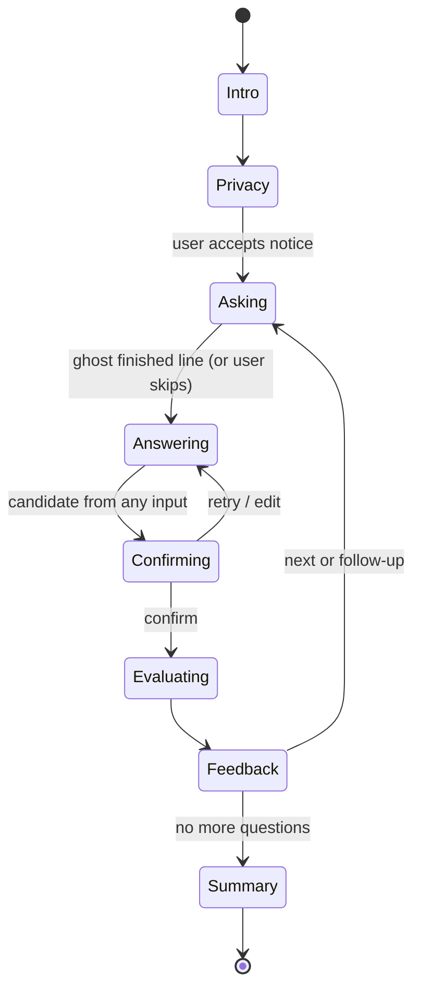

# Ghost Examiner: Architecture

Status: **FINAL** (approved 2026-11-10). Specs in `.kiro/specs/` implement this document. Changes go through a new decision entry here.

## 1. Overview

The **kit** (the reusable skeleton) is three packages under `packages/`. The two apps under `apps/` are built only from the kit.

```
packages/core  @ghost-examiner/core  pure TS: no React, no DOM   inputs contract, Morse, engine, ghost state, speech timeline, LLM, i18n
packages/web   @ghost-examiner/web   TS + browser APIs, no React  Web Speech, getUserMedia, MediaPipe, pdf/docx parsing, fetch providers, effect runtime
packages/ui    @ghost-examiner/ui    React                        <Ghost>, captions, input widgets, confirm dialog, privacy notice, app shell
apps/ghost-interview, apps/ghost-defense                          content + config + screens, built only from packages/*
netlify/functions/llm.mts                                         thin proxy, reuses @ghost-examiner/core prompt templates
```

Dependency direction: `apps → ui → web → core`. `core` depends on nothing in the repo.

Time and side effects reach the core only through injected interfaces (`Clock`, `SpeechOutput`, `InputAdapter`, `LLMProvider`), so core logic is deterministic and testable with fast-check in Node.

## 2. Decisions

### D1. Kit package split: **core / web / ui** (decided)
- `core` has no `react` dependency and its tsconfig uses `lib: ["ES2022"]` without DOM types, so a React import or a `window` reference fails typecheck. Core tests run in plain Node.
- `web` has DOM types but no `react` dependency.
- `ui` is the only React package.
- Rejected: two packages (DOM leakage only caught by convention); one package with lint rules (easy to bypass).

### D2. Ghost rendering: **hand-authored SVG + CSS transforms + one `requestAnimationFrame` loop** (decided)
Tiny, every part addressable from code, crisp, easy to theme for contrast, reduced motion in CSS. Rejected: Lottie (~250 KB runtime, hard to drive per-phoneme mouths), Rive (WASM runtime, editor learning curve), Canvas (no DOM structure for a11y and tests).

### D3. Lip-sync and captions: **text-driven speech timeline** (decided)
`speechSynthesis` exposes no audio stream, so amplitude-based lip-sync is impossible with browser TTS. `buildTimeline(text, locale, rate)` turns a line into word cues with approximate visemes (rest, A, E/I, O, U, M/B/P, F/V). The mouth and the captions read the same timeline. `boundary` events re-sync it when the browser fires them; a clock drives it when muted. Rejected: audio amplitude (needs cloud TTS or recordings), Rhubarb (scripted lines only).

### D4. State machines: **hand-written reducers with effects as data** (decided)
`reduce(state, event) → { state, effects }`; a small runtime in `packages/web` executes effects. No dependency, ideal for property tests. Rejected: XState v5 (extra dependency and concepts for a short solo project).

### D5. Optional camera (decided)
- **Tier 1 (main schedule)**: mirrored self-view tile like a video call, off by default, local only, no ML.
- **Tier 2 (stretch goal, only if ahead of schedule)**: MediaPipe Face Landmarker, lazy-loaded, ~10 fps, coarse signals only (`facePresent`, normalized head position) for the ghost's eye contact.
- Ethics (in steering): never infer emotions from the camera; never use camera data in evaluation or feedback.
- MediaPipe WASM and model files load from a CDN. Only model files are downloaded; no frames leave the device.

### D6. Voice input: **Web Speech API `SpeechRecognition`** (decided)
Free, no bundle cost, ES and EN. Not in Firefox; in Chrome, audio is usually processed on Google servers, which the privacy notice states. Feature-detected; if missing, keyboard and Morse remain. On-device Whisper is future work.

### D7. LLM access: **demo always + Netlify proxy by default + optional BYOK** (decided)
| Option | Judge UX | Cost / risk | Privacy |
|---|---|---|---|
| A. Demo only (scripted + heuristics) | Works always | Zero | Nothing leaves the device |
| B. Netlify Function proxy holding the owner's key | Real AI with no setup | Quota exhaustion (fallback), abuse (fixed tasks + rate limit), small function compute | Provider free-tier terms apply |
| C. Bring your own key | User pastes a key | Zero for the owner | User's own provider terms |
| D. Key in client bundle | n/a | Key leaks | **Rejected** |

- Provider chain in the client: `BYOK (if set) → Proxy → Demo`, falling back automatically on `rate-limited`, `unavailable` or `bad-output`, with a non-blocking notice in the ghost's voice.
- The proxy accepts only **task-shaped requests** (`generate-questions`, `evaluate-answer`, `follow-up`) with size caps; prompts are built server-side from `@ghost-examiner/core` templates.
- Per-IP rate limit via the function's `config.rateLimit` (Free plan: code-based rules, per IP + domain, 2 rules per project) ([Netlify rate limiting](https://docs.netlify.com/manage/security/secure-access-to-sites/rate-limiting/)).
- The Google project behind the key has **no billing**, so quota exhaustion returns 429 and costs nothing. On the free tier, Google may use content to improve its products and human reviewers may read it ([Gemini API logs policy](https://ai.google.dev/gemini-api/docs/logs-policy)); hence the privacy warning. Groq states it does not retain inference data by default and may keep abuse logs up to 30 days ([GroqCloud: Your data](https://console.groq.com/docs/your-data)).
- The function never logs request bodies. Model names live in config.

### D8. Hosting: **one Netlify site + GitHub Pages mirror** (decided)
What we know about the Netlify Free plan:
- **Confirmed in Netlify's billing docs**: 300 credits per month with a hard limit; a production deploy costs 15 credits; deploy previews and branch deploys are not metered; web bandwidth costs 20 credits per GB ([credit-based plans](https://docs.netlify.com/manage/accounts-and-billing/billing/billing-for-credit-based-plans/credit-based-pricing-plans/)).
- **Not described in the billing docs we read**: what happens to a live site at the limit. Netlify's plan comparison page says Free projects pause until the next billing cycle ([Pro vs Free](https://www.netlify.com/pricing/pro-vs-free/)), and community threads report deploys blocked by a stale credit flag. We treat a pause as possible and plan for it.

Decisions:
- **One site** serves `/` (landing), `/interview/` and `/defense/`. One deploy = 15 credits for both apps.
- **Production branch is `release`**, not `main`. Work on `main` and PRs produces branch deploys and deploy previews, which are not metered. A production deploy means updating `release`, and **requires the owner's approval every time**. Budget: at most 10 production deploys per month.
- MediaPipe models and large assets come from CDNs, not Netlify bandwidth.
- **Mirror**: a GitHub Actions workflow publishes the same build to GitHub Pages in demo + BYOK mode (no proxy). Demo mode needs no backend, so the mirror stays usable if Netlify pauses. Linked from the README.

### D9. Validation of LLM output: **hand-written type guards** (decided)
Zero dependencies. valibot only if guards get messy, after asking.

### D10. Document parsing (ghost-defense) (decided)
Local only, lazy-loaded: `pdfjs-dist` for PDF, `mammoth` for DOCX, plain text and Markdown natively. Size cap (about 2 MB, ~50 pages). Text is split into sections locally; only selected excerpts go to the LLM in real mode. In demo mode, a heuristic question generator (headings + key sentences + templates) works offline.

### D11. Sign input: **stretch goal** (decided)
Spec (g) runs only if the main schedule is ahead. It reuses the camera stream with MediaPipe Hand Landmarker and a k-nearest-neighbors classifier over the user's own samples, labeled Experimental, never described as translation.

## 3. Core interfaces (sketch; finalized in specs)

### 3.1 InputAdapter (`packages/core/src/input`)
```ts
export type InputMethodId = 'keyboard' | 'voice' | 'morse' | 'sign';
export type AnswerKind = 'free-text' | 'choice' | 'yes-no';

export type Availability =
  | { available: true }
  | { available: false; reason: MessageKey }; // shown to the user, localized

export interface InputContext {
  question: QuestionView; // id, kind, choices, locale
  locale: Locale;
}

export type InputEvent =
  | { type: 'status'; status: 'idle' | 'listening' | 'processing' }
  | { type: 'partial'; text: string }                  // live preview
  | { type: 'candidate'; candidate: AnswerCandidate }  // ready for confirmation
  | { type: 'error'; code: InputErrorCode; recoverable: boolean };

export interface AnswerCandidate {
  text: string;
  method: InputMethodId;
  confidence?: number;     // 0..1 when the method provides one
  alternatives?: string[]; // e.g. other speech hypotheses
  trace?: string;          // e.g. ".-- . ..." for Morse, shown on the confirm screen
}

export interface InputAdapter {
  readonly id: InputMethodId;
  readonly requires: { camera: boolean; microphone: boolean };
  readonly experimental: boolean;
  readonly supports: readonly AnswerKind[];
  checkAvailability(): Promise<Availability>;
  start(ctx: InputContext, emit: (e: InputEvent) => void): void;
  stop(): void;
}
```
- **Confirmation is enforced by type**: adapters emit only `AnswerCandidate`; evaluators accept only a branded `ConfirmedAnswer`, which only the engine's `confirm` transition creates. The confirm screen offers confirm, edit and retry.
- **Two input methods per question**: keyboard and Morse need no hardware and support every `AnswerKind`. A question-pack validator rejects any question supported by fewer than 2 registered adapters; the engine also checks at runtime.
- Morse timing uses an injected `Clock`; the classifier is a pure function of press/release timestamps and user-adjustable thresholds.

### 3.2 Question engine (`packages/core/src/engine`)
```ts
export interface Question {
  id: string;
  kind: AnswerKind;
  prompt: Localized<string>;      // generated questions fill the session locale only
  choices?: Localized<string>[];
  keyPoints?: Localized<string[]>; // heuristic evaluation and LLM rubric
  source?: { excerptId: string };  // ghost-defense: which part of the document
}

export interface QuestionSource { next(history: SessionHistory): Promise<Question | null>; }

export interface Evaluator {
  evaluate(q: Question, a: ConfirmedAnswer, locale: Locale): Promise<Feedback>;
}

export interface Feedback {
  summary: string;
  strengths: string[];
  improvements: string[];
  followUp?: Question;
  reaction: GhostReaction;
}

export function reduce(state: SessionState, event: SessionEvent): { state: SessionState; effects: Effect[] };
```

Property tests on `reduce`: for any event sequence, (1) `evaluate` is emitted only after `confirm` of the same candidate, (2) no phase sets a time limit, (3) while answering, at least 2 methods are offered.

### 3.3 Ghost state machine (`packages/core/src/ghost`) and `<Ghost>` (`packages/ui`)
```ts
export type GhostActivity = 'idle' | 'speaking' | 'listening' | 'thinking' | 'reacting';
export type Expression = 'neutral' | 'attentive' | 'skeptical' | 'approving' | 'amused' | 'thinking' | 'surprised';
export type Viseme = 'rest' | 'A' | 'E' | 'O' | 'U' | 'MBP' | 'FV';

export interface GhostPose {
  activity: GhostActivity;
  expression: Expression;
  viseme: Viseme;
  gaze: { x: number; y: number }; // -1..1; follows the user's face only in camera tier 2
  blink: boolean;
  float: number;                  // body bob; always 0 with reduced motion
}

export function ghostPose(state: GhostState, now: number, opts: { reducedMotion: boolean }): GhostPose; // pure
```
- `<Ghost pose={pose} />` is a pure SVG view; a `useGhost()` hook runs the rAF loop and writes through refs.
- Reactions come from engine events (typing or speaking → listening; long silence → thinking pose, no visible timer; confirm → clipboard scribble; feedback → approving, skeptical or amused).
- `role="img"` with a localized label describing the current expression. Captions and transcript live outside the SVG.

### 3.4 Speech output and captions
```ts
export interface SpeechCue { start: number; end: number; word: string; wordIndex: number; viseme: Viseme }
export function buildTimeline(text: string, locale: Locale, rate: number): SpeechCue[]; // pure

export interface SpeechOutput {          // WebSpeechOutput or SilentOutput (muted, clock-driven)
  speak(line: { text: string; locale: Locale }, onCue: (cue: SpeechCue) => void): Promise<void>;
  cancel(): void;
}
```
Captions show the full line and highlight the current word; the transcript keeps history and announces each finished line once (`aria-live="polite"`).

### 3.5 Camera module (`packages/web/src/camera`)
```ts
export interface CameraSignals { facePresent: boolean; head?: { x: number; y: number } }
export interface CameraModule {
  start(video: HTMLVideoElement): Promise<void>; // only after an explicit user click
  stop(): void;                                  // stops all tracks, releases the device
  onSignals(cb: (s: CameraSignals) => void): () => void; // tier 2 only
}
```

### 3.6 LLM provider (`packages/core/src/llm`)
```ts
export type LLMTask = 'generate-questions' | 'evaluate-answer' | 'follow-up';

export interface LLMRequest {
  task: LLMTask;
  locale: Locale;
  input: TaskInput<LLMTask>;  // typed per task, size-capped
  maxOutputTokens: number;
}

export type LLMResult =
  | { ok: true; text: string }
  | { ok: false; error: 'rate-limited' | 'unavailable' | 'invalid-key' | 'bad-output' | 'too-large' };

export interface LLMProvider {
  readonly id: 'demo' | 'proxy' | 'gemini' | 'groq';
  readonly isDemo: boolean;
  complete(req: LLMRequest): Promise<LLMResult>;
}

export function withFallback(...chain: LLMProvider[]): LLMProvider;
```
- `DemoProvider` is deterministic and seeded.
- `GeminiProvider` and `GroqProvider` use `fetch` against the REST APIs (Groq via its OpenAI-compatible endpoint); browser CORS is verified in a spike before BYOK is built.
- Prompt templates and output guards live in `packages/core`, shared by client and server.

## 4. Repository layout
```
/.kiro/                  steering, specs, hooks, skills, settings (tracked)
/apps/                   exactly two apps
  ghost-interview/       Vite + React app: src/, content/packs/, e2e/
  ghost-defense/         Vite + React app: src/, content/samples/ (fictional docs), e2e/
/packages/               the kit (reusable skeleton)
  core/                  @ghost-examiner/core  (no React, no DOM)
    src/input  src/morse  src/engine  src/ghost  src/speech  src/llm  src/i18n
  web/                   @ghost-examiner/web   (browser adapters, effect runtime)
    src/inputs  src/speech  src/camera  src/docs  src/llm  src/runtime
  ui/                    @ghost-examiner/ui    (React components, styles, tokens)
/netlify/functions/llm.mts
/site/index.html         landing page linking both apps (static, not an app)
/scripts/                build-site: merges app builds into dist/interview and dist/defense
/docs/                   ARCHITECTURE.md, KIRO_USAGE.md, PRIVACY.md
LICENSE  README.md  package.json  pnpm-workspace.yaml  tsconfig.base.json  netlify.toml
```

## 5. Testing approach
- `packages/core`: Vitest in Node + fast-check.
- `packages/web`, `packages/ui`: Vitest + jsdom, fakes for browser APIs.
- Apps: Playwright e2e in demo mode with `@axe-core/playwright` (WCAG 2.2 AA tags), both motion settings, EN and ES.
- In-browser verification through Playwright MCP (Chromium) before each task is marked done.

## 6. Schedule (planned backwards from the Dec 1 freeze)
Day 1 is Nov 11. Submission is Dec 2; the official deadline (Dec 4) is buffer only.

| Dates | Day | Work |
|---|---|---|
| Nov 11 to 15 | 1 to 5 | Spec (a): kit skeleton, animated ghost, muted captions, minimal keyboard input, engine, demo evaluation, deploy pipeline |
| **Nov 15** | **5** | **Checkpoint: vertical slice on a public URL** (ghost, one question, keyboard, confirmation, demo evaluation) |
| Nov 16 (morning) | 6 | Spec (a) phase 2: remaining expressions and mouth shapes, floating + motion toggle, full axe matrix |
| Nov 16 (afternoon) to Nov 19 (morning) | 6 to 9 | Spec (b): voice input, TTS with lip-sync and captions (shifted half a day) |
| Nov 19 (afternoon) to 20 | 9 to 10 | Spec (c): Morse input + property-based tests (1.5 days, shortened by the half-day shift) |
| Nov 21 to 22 | 11 to 12 | Spec (d): camera tier 1 (self-view) |
| Nov 23 to 25 | 13 to 15 | Spec (e): ghost-interview, real LLM providers, Netlify proxy, evaluator failure path requirement (Netlify power decision Nov 14 to 15) |
| Nov 26 to 28 | 16 to 18 | Spec (f): ghost-defense (document upload, question generation, injection defenses) |
| Nov 28 (stretch) | 18 | Package our skills as a Kiro Power (Agent Plugins format: `plugin.json` with keywords + `skills/`) for the Skeleton Crew story. Only if ahead of schedule. |
| Nov 29 to 30 | 19 to 20 | GitHub Pages mirror, full a11y sweep, README, KIRO_USAGE, demo video |
| **Dec 1** | **21** | **Feature freeze + final production deploy** (owner approval) |
| **Dec 2** | **22** | **Submit** |

Stretch goals, only if ahead of schedule: camera tier 2 (face signals for gaze), spec (g) experimental sign input, and the Kiro Power package of our skills (Nov 28).
